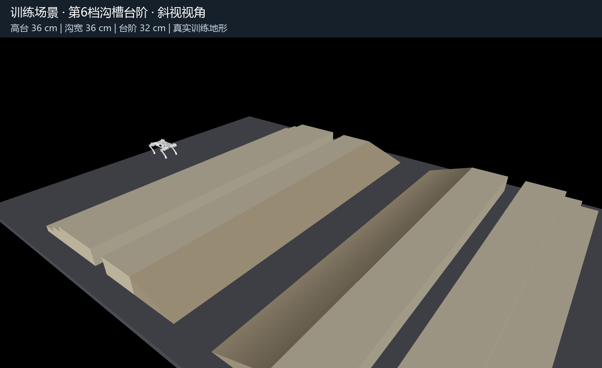
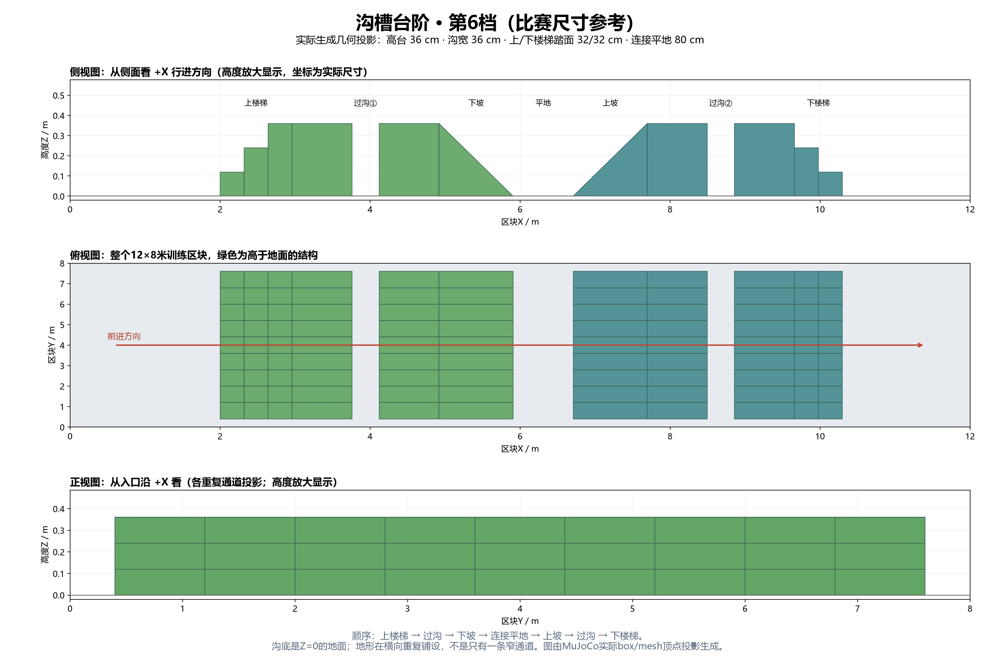

# mjlab_MGDP · LgDog1 深度感知四足运动

<p align="center">
  
  
</p>

<p align="center">
  <a href="https://github.com/heartpain-kong/mjlab_MGDP"></a>
  
  
  
</p>

基于 [mjlab](https://github.com/mujocolab/mjlab)（MuJoCo-Warp 上的 GPU 并行 RL 框架）搭建的
四足机器人 LgDog1 深度感知训练工程，用于 **2027 年足式机器人挑战赛**的障碍赛道：
10 类课目、8 档渐进课程、单目深度感知（MGDP 编码器）、终点判定与教学回放工作台。

## 特性

- **MGDP 深度感知**：32×24（当前主干）/ 16×16（历史）深度 → CNN+GRU 特征，冻结感知权重接入 PPO
- **10 类比赛课目**：沟壑台阶、高墙、限高笼、轮胎阵、梅花桩、单木桥、绕桩接砖木坑、平地、起伏、粗糙
- **多维课程**：地形难度、速度分组、指令带宽、相对进展（>progress_curriculum）、满级配额
- **奖励工程**：墙前等待/越墙/摆腿清障/轮胎内孔/边缘落脚惩罚/二阶动作平滑/绕障作弊惩罚
- **加速与诊断**：LGDOG_WALL_LESSONS / LGDOG_WALL_COLS 地形裁剪、地形分布快照、passage_diagnostics
- **回放与工作台**：scripts/play.py 逐课目录像，
un_lgdog.sh server start 起 Web 工作台（8088）

## 与官方 MGDP 的差异

本仓库沿用官方 MGDP 的深度感知骨架，但改了**感知训练方式、控制器输入和越障课程**：
官方在运动训练中继续在线更新感知，本仓库**先离线预训练感知、再冻结训练 PPO**。
逐项对比（平台、深度输入、网络、观测维度、课程）见 [doc/MGDP_COMPARISON.md](doc/MGDP_COMPARISON.md)。

## 开源策略

`release/` 目录附带一份可直接部署运行的策略（第 12400 轮，十类地形 9/10）：

```bash
git checkout policy-v1          # 该策略匹配的代码版本
bash release/play_policy.sh <策略目录>
```

录制素材（十段实测评测录像 + 合成整片 + 总览图 + 训练曲线）在 `release/media/`，
录制导出方法与脚本见 `release/media/README.md`；成绩记录见 `release/eval_results.md`。

> **注意**：`main` 主干已经把深度改为 32×24 + stride 卷积编码器，并调整了地形与奖励，
> 与 `policy-v1` 时代的策略**不兼容**；回放旧策略请务必切到 `policy-v1` 标签。

## 一键部署

```bash
git clone https://github.com/heartpain-kong/mjlab_MGDP.git
cd mjlab_MGDP
bash scripts/deploy.sh                       # 创建 conda 环境 lgdog + 安装依赖 + 自检
bash scripts/deploy.sh --start --ui-port 8088  # 安装并启动工作台
```

- 无 sudo 权限：`bash scripts/deploy.sh --skip-system-deps`
- 只跑自检：`python scripts/verify_install.py`
- 环境已存在时可跳过安装，直接 `bash run_lgdog.sh server start --ui-port 8088`

### 仓库结构

| 路径 | 内容 |
|---|---|
| `src/tasks/velocity/` | 任务、地形、奖励、课程、命令、感知（核心代码） |
| `src/config/` | LgDog1 关节/感知/技能引导与阶段配置 |
| `src/assets/` | 机器人 XML/URDF、地形资源 |
| `src/dashboard/` · `src/portal/` | Web 工作台与本地门户（8088 / 8770） |
| `scripts/` | 训练、回放、预训练、录制、诊断、部署脚本 |
| `tests/` | 回归测试（`python -m pytest -q tests/`） |
| `release/` | **开源策略 + 录制素材 + 评测记录** |
| `doc/` | 设计文档（含 WMP/SSR 迁移调研） |
| `deploy/` | 服务器部署与系统环境脚本 |

根目录脚本一览：

| 脚本 | 用途 |
|---|---|
| `configure_lgdog.sh` | 建 conda 环境、装依赖、自检（被 `scripts/deploy.sh` 调用） |
| `install_ubuntu.sh` | venv 版安装（不用 conda 时） |
| `run_lgdog.sh` | 工作台/dashboard 的启动、停止、状态 |
| `tools/run_web.sh` · `tools/run_web.cmd` | 本地浏览器工作台（Windows 用 .cmd） |
| `tools/tb.sh` · `tools/kline.sh` | TensorBoard / K 线看板 |
| `tools/` | 开发/运维脚本目录（见下） |
| `tools/lgdog.py` | 训练入口封装（任务别名、常用参数） |
| `deploy_server.sh` · `tools/upload_server.ps1` · `server_env.sh` | 服务器部署与打包上传 |

> 媒体文件只保留汇总图与短视频，训练曲线原图在本地 TensorBoard。

## 快速开始

```bash
# 安装（详见下方 Ubuntu 一键安装）
bash configure_lgdog.sh

# 感知预训练（主干当前为 32x24）
python -m scripts.pretrain_mgdp --task LgDog1-Race-MGDP-WallTraining-D435i20 \
  --depth-profile d435i_edge16_down20 --num-envs 64 --terrain-rows 8 --terrain-cols 10 \
  --batch-size 64 --steps 4000 --iterations 3000

# 训练（9 课目、6144 环境、8000 轮）
export LGDOG_WALL_LESSONS=start_flat,stepping_stones,balance_beam,gap_steps,high_wall,clearance_frame,tire_array,mjlab_rough,slalom_brick
python -m scripts.train LgDog1-Race-MGDP-WallTraining-D435i20 \
  --env.scene.num-envs=6144 --agent.max-iterations=8000 --agent.logger=tensorboard \
  --enable-nan-guard True --agent.run-name=V19_seed42
```

---

# LgDog · mjlab 训练工作台

## Ubuntu 一键安装

推荐用 Conda（环境名 **`lgdog`**，会写入 CUDA 驱动激活钩子并做 GPU 自检）：

```bash
cd mjlab_MGDP
bash configure_lgdog.sh          # 可选 --skip-system-deps / --torch-index / --start --ui-port 8088
conda activate /root/gpufree-data/conda/envs/lgdog
```

不装 Conda 时，用 venv 版本：

```bash
cd mjlab_MGDP
bash install_ubuntu.sh
source .venv/bin/activate
python scripts/verify_install.py
```

脚本会安装系统编译库、创建环境、安装锁定的 mjlab/MuJoCo/Warp 组合、以 editable 模式安装当前源码，并检查 LgDog 任务是否注册成功。默认使用 Python 3.10–3.13 和 PyPI 的 PyTorch GPU 包；只有做 CPU 导入检查时使用 `--cpu`。显卡训练仍需要 NVIDIA 驱动和可用 CUDA 驱动。

已有系统依赖或没有 sudo 权限时：

```bash
bash configure_lgdog.sh --skip-system-deps
```

需要指定 PyTorch CUDA 源时：

```bash
bash configure_lgdog.sh --torch-index https://download.pytorch.org/whl/cu128
```

详细参数见 [doc/CONDA_LGDOG.md](doc/CONDA_LGDOG.md) 与 [doc/setup_zh.md](doc/setup_zh.md)；GPUFree 平台的 CUDA、SSH 转发和显存记录见 [doc/DEPLOYMENT_GPUFREE.md](doc/DEPLOYMENT_GPUFREE.md)。

## 运行

在已安装训练依赖的 Python 环境中，进入这个目录：

```bash
python tools/lgdog.py
```

浏览器打开 **http://127.0.0.1:8765**。选择任务后，可以启动训练、play 回放、sim2sim、查看奖励和真实日志。默认任务是 **HIM-PPO + 标准崎岖地形盲走**。

MGDP 深度感知作为独立任务（别名 `mgdp`）使用，首次训练前先跑一次感知预训练（见 [MGDP 说明](doc/MGDP_MJLAB.md)）：

```bash
python scripts/pretrain_mgdp.py --num-envs 256 --steps 4000 --iterations 3000
```

```bash
python tools/lgdog.py tasks                      # 看全部任务的短名称（默认 standard）
python tools/lgdog.py web                        # 总览：环境/GPU/进程/轮次/日志一页看完（端口 8770）
python tools/lgdog.py kline                      # 曲线终端：把 TensorBoard 曲线当 K 线看（端口 8766）
python tools/lgdog.py train standard --envs 1024 --iterations 16000
python tools/lgdog.py play standard              # 自动选对应任务最新 checkpoint
python tools/lgdog.py sim standard --vx 0.4      # 自动选对应任务最新 ONNX
python tools/lgdog.py rewards standard --term foot_clearance

# MGDP 深度感知（需先预训练）
python tools/lgdog.py train mgdp --envs 2048 --iterations 10000
# 定向越障 v2：入口→障碍→出口，按各类通过率门控扩速
python tools/lgdog.py train race_mgdp --envs 2048 --terrain-num-rows 8 --terrain-num-cols 20 --iterations 16000
# 2027 比赛场地：python tools/lgdog.py train race --envs 4096
```

正式训练示例：`python tools/lgdog.py train standard --envs 1024 --iterations 16000 --run-name V8_him_standard_seed42`。环境数应按显存调整。面板本身仅用 Python 标准库；训练仍需要原来的 mjlab / MuJoCo / PyTorch 环境。

MGDP v2 关闭抬腿高度奖励，启用 `feet_air_time`，区分机身与腿部擦碰；使用新的 `_v2` 实验目录。`race_mgdp` 的方向、低速起点和通过率门控由任务管理，不能直接完整续训旧 MGDP_V3。详见 [定向越障配置与验证](doc/MGDP_PASSAGE.md)。

## 2027 比赛场地

`27rc-dog-race` 的障碍赛/任务赛场地已经接入训练和 sim2sim：

```bash
# 真场地：启动区起步，0.4 m/s 往前走
python scripts/sim2sim.py LgDog1-Race-Blind-HIM --onnx=<policy.onnx> --map race --vx 0.4 --duration 5

# 比赛地形课程：梅花桩 0.2×0.2×0.1、单木桥 0.4 宽、台阶 0.12/0.32、砖木坑、绕桩、0.3 m 高墙
python tools/lgdog.py train race --envs 4096 --iterations 16000
```

训练地形是「按规则尺寸拼的近似」：轮胎阵和限高框架不是地面高度场，只在 sim2sim 的真场地里练。
完整对照表、坐标、换规则时怎么重新转换，见 [doc/RACE_COURSE.md](doc/RACE_COURSE.md)。

## 一个网页看全部：mjlab 总览

```bash
python tools/lgdog.py web        # 浏览器打开 http://127.0.0.1:8770
bash tools/run_web.sh            # Linux 等价入口（Python 解释器沿用 run_lgdog.sh 的规则）
tools/run_web.cmd                # Windows 双击
```

**训练状态、显卡、磁盘、环境版本、相关进程、全部训练轮次、日志尾巴**收在一页，并且默认顺手带起
工作台（:8765）和曲线终端（:8766）—— 只记一个地址就够了。轮次表格直接读曲线终端解析好的指标，
点「K线」跳到对应轮次的蜡烛图。页面只读系统状态，唯一的写操作是启停**本页启动的**子服务。
细节和开机自启写法见 [doc/WEBHUB.md](doc/WEBHUB.md)。

## 看曲线：曲线战士（TensorBoard 转 K 线）

```bash
python tools/lgdog.py kline            # 浏览器打开 http://127.0.0.1:8766
```

把 `logs/rsl_rl` 下的标量曲线按训练步切成蜡烛图：分时曲线、短/中/长/全程 K、MA 均线、波动柱、
自选轮次、最近 5 根高低、逐点流水，外加「全部指标 / 轮次对比 / 数据体检 / 指标词典 / 导出 CSV」。
只读本机 event 文件，不联网；第一次读大的 run 要十几秒，之后走 `logs/kline_cache/` 秒开。
细节见 [doc/KLINE.md](doc/KLINE.md)。

## 日常只需要找这几处

| 位置 | 用途 |
|---|---|
| `tools/lgdog.py` | 统一入口：浏览器面板与简短命令 |
| [reward_cfg.py](src/tasks/velocity/config/lgdog1/reward_cfg.py) | 奖励权重、参数；新标准 HIM 修改 `him_standard` |
| `src/tasks/velocity/config/lgdog1/` | 地形、观测、课程、任务注册与 PPO 配置 |
| `logs/rsl_rl/` | 训练 checkpoint、ONNX、TorchScript 和配置快照 |
| `logs/dashboard/` | 面板启动的进程记录与输出日志 |
| `logs/kline_cache/` | 曲线终端的 event 解析缓存（可随时删，删了会重解析） |
| `logs/web/` | 总览拉起的三个服务的输出日志 |
| `src/kline/` | 曲线终端：event 解析、窗口聚合、只读 HTTP 服务与页面 |
| `src/portal/` | mjlab 总览：环境/GPU/进程采集、服务管理、只读 HTTP 服务与页面 |
| `src/assets/terrains/` | 地形资产：LgDog 测试图 + 2027 比赛场地（`race_*.xml`） |
| `scripts/import_race_course.py` | 把比赛场地仓库转换成工程地形 XML（规则更新时重跑） |
| [doc/](doc/INDEX.md) | 使用与技术文档 |
| `archive/` | 旧补丁、旧验证记录和历史清单 |

每个 HIM checkpoint 会额外生成 `policy_jit.pt`（TorchScript 推理模型）；`policy.onnx` 仍保留用于现有 sim2sim 和部署链路。

- [面板操作与目录迁移说明](doc/WORKBENCH.md)
- [mjlab 总览（一个网页看全部）](doc/WEBHUB.md)
- [曲线终端（TensorBoard 转 K 线）](doc/KLINE.md)
- [2027 比赛场地：训练与 sim2sim](doc/RACE_COURSE.md)
- [标准地形 HIM 训练说明](doc/LGDOG_HIM_STANDARD.md)
- [MGDP 深度感知迁移与训练](doc/MGDP_MJLAB.md)
- [奖励调参](doc/REWARDS.md)
- [环境安装](doc/setup_zh.md)
- [GPUFree Ubuntu 部署记录](doc/DEPLOYMENT_GPUFREE.md)

目录已从 `unitree_rl_mjlab_lgdog/unitree_rl_mjlab_lgdog/` 合并为一层，训练日志和模型随工程一起保留。原有 `scripts/train.py`、`play.py`、`sim2sim.py` 仍可直接运行。上游中英文 README 保存在 `doc/UPSTREAM_README*.md`。

## 许可证

本仓库以 **MIT** 协议开源，见 [LICENSE](LICENSE)。

上游组件仍按其原协议使用：mjlab / MuJoCo（Apache-2.0）、rsl-rl-lib / legged_gym（BSD-3-Clause）、
MGDP 感知骨架（以原仓库为准）。完整声明见 [NOTICE](NOTICE)，Apache-2.0 全文见
[LICENSES/Apache-2.0.txt](LICENSES/Apache-2.0.txt)。
