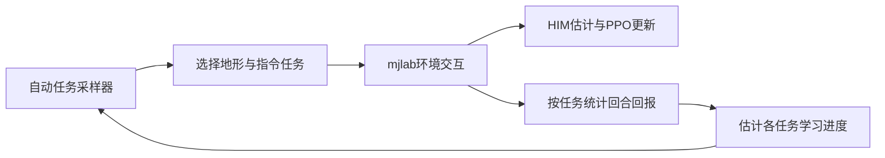
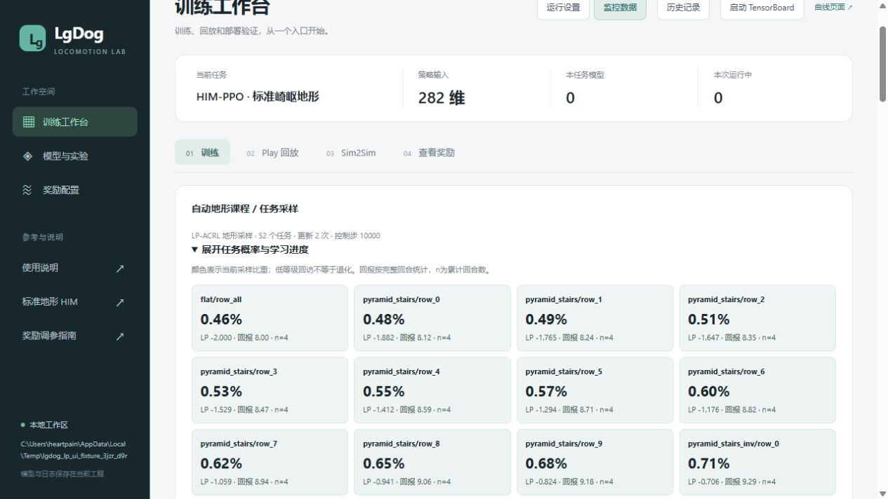

# LP-ACRL与LgDog盲走课程的接入设计

2026-10-27。已实现第一阶段：**固定速度包络下的地形任务LP采样**，包含手工、均匀对照、LP-ACRL三种可选模式。联合地形—速度分桶仍为后续设计，尚未实现。手工速度课程见 [VELOCITY_CURRICULUM.md](VELOCITY_CURRICULUM.md)。

## 核对的来源

- [原论文，方法III-B与部署IV-E](https://arxiv.org/html/2601.17428v1)。
- [作者出版记录：RA-L 2026](https://breadli428.github.io/publication/ral2026-2/)。
- [官方项目页](https://sites.google.com/view/lp-acrl)，含用户提供的视频。
- [社区速度课程研究仓库](https://github.com/FIBO-Physical-AI/curriculum_training)及其 [teacher_guided.py](https://github.com/FIBO-Physical-AI/curriculum_training/blob/main/src/source/curriculum_rl/curriculum_rl/curricula/teacher_guided.py)。该仓库自述为Go2速度分桶研究，不能标成ETH官方实现，也不能当作完整多地形复现。

论文核心是对同一任务的平均回合回报求前后差，再按带温度的softmax调整任务概率：

```text
LP[i] = mean_return_current[i] - mean_return_previous[i]
probability[i] = softmax(LP / temperature)[i]
```

LP保留符号；改成绝对值即变成另一种规则。无需人工规定任务先后顺序，并不意味着无需限定地形参数范围或离散任务空间。论文的崎岖地形部署涉及高度图与教师—学生蒸馏，不能直接以其结果承诺LgDog盲走性能。

截至本次核查，官方项目页/作者页面未发现可确认的官方训练仓库链接；本地资料库代码目录也只有说明。社区代码可供接口研究，尚未进行训练结果复核。

## 我们项目中的位置



以下是本项目的工程实现与后续设计，不是ETH官方代码或论文原始超参数。

| 部分 | 接入方案 |
|---|---|
| HIM估计器、Actor/Critic、PPO | 保持当前实现和观测合同 |
| 部署actor | 继续盲走，不输入任务ID、地形类别或扫描图 |
| 机器人/PD/动作映射 | 保持原配置，避免同时改变本体控制 |
| 地形生成器 | 沿用原生七类生成器及已编辑范围 |
| 自动课程 | 改变reset时的任务采样分布 |
| 训练奖励 | 每个对照实验内冻结，独立于LP概率更新 |

## 分两步验证

**第一步：固定速度包络，只学习地形采样。**

在有限的地形类型与几何区间上建立任务表。平地不需要重复的高度等级；若随机地形不同“行号”并不改变生成分布，也不能机械地当成不同任务。类型要通过实际地形列映射确定，不能把列号直接当七类类型ID。

当前mjlab的 `update_env_origins()` 主要沿既有类型升降等级。LP模式需要在reset时共同选择类型、等级和出生原点；修改一个 `proportion` 不能代替运行期间的自适应采样。已有预生成tile可复用，先不增加地形数量或接触缓冲容量。

这个阶段固定速度范围，避免“速度变难引起回报下降”被误判成地形任务退步。保留同范围的均匀采样作为对照。

**第二步：联合地形与速度任务。**

任务可扩展为“地形类型 × 几何参数区间 × 速度区间”，再视样本量决定是否加入偏航区间。范围仍使用LgDog已验证的包络，不直接照抄ANYmal的高速目标。站立单列任务；正反向能力是否共用统计应通过本体实测决定。

每个环境保存整回合不变的 `task_id`。当前指令每3–5秒重采样，LP模式下应始终在本回合对应的速度桶内重采样，不能跨桶后把整回合奖励记给最后一个桶。先结算旧任务，再采样下一个任务。

## 与现有门控的关系

已提供三个互斥实验模式：手工门控、同任务集合均匀采样、LP自动采样，工作台训练参数区可选择。自动模式关闭旧地形±1和全局速度扩张，三者不会同时控制相同维度。

- 手工模式保留当前速度进度门与地形升降规则，作为基线。
- LP接管地形时，旧地形±1更新仅保留诊断，不再修改该次reset采样的等级。
- LP联合接管速度后，旧全局扩速器也停止控制相同维度，避免两套逻辑互相覆盖。
- 存活、完成度、失败与接触继续记录并用于评价；若额外给LP加“通过硬门才允许采样”的限制，须明确标成混合课程变体。

## 概率估计与状态保存

当前独立维护每任务的样本数、回报均值、上期均值、LP、采样概率和最近更新时间。低样本任务不因一次高回报立即获得极高概率；未采样任务不能当作回报为0。先采用统一统计窗口，验证后再研究平滑方法。

可试验小比例均匀探索以防任务饿死，并保留易任务用于复习；这一混合比例是工程选择，不能写成论文默认值。温度必须显式配置，并观察是否出现单任务概率独占。

checkpoint应保存采样器统计、随机数状态及任务表/奖励配置签名。恢复时如果地形区间或reward配置变了，旧回报差不再可比，需要清空相应统计；否则面板调权重本身就会制造假的“学习进度”。

## 评价与工作台

工作台应展示各任务的采样概率热图、样本数、LP、回报与失败率。对LP模式，单一 `level_mean` 不再表示应当单调上升的训练进度：主动复习低等级会降低它，不能据此判定退化。

固定评估集应独立于训练采样概率，记录每地形/速度桶的指令完成度、相对追踪误差、提前失败和腿部接触。可增加论文的EPTE-SP作为参考评价，站立与近零指令需单独定义有效归一化，不能用它们稀释移动误差。

V23的高绝对分数、低有效进度问题仍需解决。LP改变练习配比，不会自动纠正方向错误的奖励或欠速评价。先固定配置对比手工/均匀/LP，再扩大任务维度；CPU采样测试不能替代GPU训练和固定指令回放。

## 验证项目

1. 正LP获得更高采样概率、全等LP得到均匀分布、负LP不是取绝对值。
2. 无样本/低样本任务的处理不产生虚假大幅进步，概率归一化并可复现。
3. 异步reset只更新结束回合的旧任务；回合内指令不跨任务桶。
4. 地形类型、行号、原点与策略reset一致，切换类型后足下射线仍读到正确地形。
5. checkpoint恢复可重现分布，配置改变会明确清空不兼容统计。
6. 同奖励、同任务集合、同样本预算下比较手工、均匀和LP；至少用多个种子与固定评估集。


## 当前使用方法

工作台“运行设置 → 训练参数 / 课程设置 → 地形课程”选择 **LP-ACRL 自动地形采样**。平地任务禁用该选择；标准Rough-HIM和其他LgDog生成式崎岖任务可用，观测与算法保持对应任务原配置。默认仍为手工模式，避免改变旧实验。

在训练机工程根目录执行（环境数按实际显存选择）：

```bash
# 只检查生成命令，不启动训练
python lgdog.py train standard --terrain-curriculum lp_acrl \
  --velocity-min-abs 0.3 --velocity-max-abs 0.5 \
  --envs 64 --iterations 2 --dry-run

# 实际训练示例：明确固定在已选速度包络内
python lgdog.py train standard --terrain-curriculum lp_acrl \
  --velocity-min-abs 0.3 --velocity-max-abs 0.5 \
  --envs 1024 --iterations 16000

# 同任务集合均匀采样对照：保持其他参数相同
python lgdog.py train standard --terrain-curriculum uniform \
  --velocity-min-abs 0.3 --velocity-max-abs 0.5 \
  --envs 1024 --iterations 16000
```

原脚本入口也可使用 `--terrain-curriculum=lp_acrl`；应先在项目已安装/PYTHONPATH正确的环境内运行。短入口会配置工程路径。上述实际训练示例没有在本次验证中执行。

### 参数与含义

| 参数 | 默认值 | 说明 |
|---|---:|---|
| `--terrain-curriculum` | `manual` | `manual`、`uniform`、`lp_acrl` |
| `--lp-temperature` | 2.0 | 按完整回合累计reward差的量级设置，不能直接套用其他实现的温度 |
| `--lp-uniform-mix` | 0.1 | 概率的10%均匀探索部分；设0可取消该工程扩展 |
| `--lp-min-episodes` | 32 | 每任务至少累计32个可比回合后才更新该任务均值 |
| `--lp-update-interval-s` | 100.0 | 仿真控制时间；50步rollout、0.02秒控制周期下约100次PPO迭代 |

首次有效均值只建立基线，下一次该任务满足样本数才得到有符号回报差；未满足样本数的任务继续累计，不把缺失数据填成0回报。没有新估计的LP置0，不持续使用过期的强信号。这些处理属于本工程的有限样本适配。

速度输入在自动模式下表示**固定包络**。例如0.3/0.5对应vx `(-0.3,0.5)`，不再先减半再扩张；横移、偏航沿用现有范围换算。若直接用原脚本且未给速度参数，则保留该任务工厂的初始范围（标准HIM为vx `(-0.2,0.4)`）。站立比例、换指令周期和heading控制仍由原任务决定，统计中的任务ID仅代表地形，不声称已实现速度桶。

### 任务数量与原生比例

标准10行、20列配置通常得到52个任务：5种随difficulty变化的地形各10行，加平地和随机起伏各1组。合并组仍可在其所有行/列的tile之间随机出生，不会删除现有地形。

原生 `proportion` 继续决定哪些预生成列属于哪类地形；**自动模式的训练采样率由任务概率决定，不再固定等于20%/10%的几何列比例**。均匀对照是按相同任务集合均匀，不是按地形类别均匀。修改比例后若某类型没有被分配到列，它就无法采样；修改网格或地形参数会改变任务签名。

### 日志、断点与界面

- `Curriculum/terrain_sampling/*` 记录模式、更新数、已结算回合数、就绪任务数、采样熵、当前等级与失败/进度诊断。
- `<run>/curriculum/terrain_sampling.json` 周期性原子更新，保存每任务概率、LP、最近有效回报均值、累计/待统计回合数、失败和进度诊断。面板“监控数据 → 自动地形课程”可展开概率热图。
- checkpoint的 `infos.terrain_task_curriculum` 保存采样器计数、回报窗口、概率和随机数状态。恢复时物理回合重新开始，不会把新环境奖励记给旧回合任务。
- 地形/奖励/命令或采样参数签名变化时，保留策略权重但明确警告并重建采样统计。旧手工checkpoint没有LP状态时也从新统计开始。
- 初始化随机episode-length造成的首批短回合、手动中途reset不计作LP完成回合；正常摔倒失败回合仍计入，其较低累计回报是有效训练反馈。

本阶段自动模式显式限制为单GPU，防止多rank独立统计却被误认为同步课程。PPO/HIM和ONNX接口未变；Play/Sim2Sim仍按原入口使用模型，训练采样器不进入部署策略。已执行CPU回归、入口参数与临时界面检查；GPU物理运行、收敛和真机效果尚未验证。


## 本次验证记录

CPU完整unittest：159项，158项通过、1项跳过。包含有符号LP、未采样任务、最少样本、稳定softmax、分布/RNG恢复、真实mjlab列映射、局部reset旧任务归属、初始短回合过滤、手动reset过滤、PPO/HIM配置、runner断点接线与HTTP状态刷新。命令预览和训练入口的LP参数帮助输出通过；未执行GPU物理训练。

临时浏览器实例验证了课程选择、参数显隐、52任务概率热图、监控页折叠，以及平地禁用自动课程。平地也不再从工作台发送地形行数/难度倍率这类生成器专用参数。临时实例已关闭，测试数据没有写入真实训练run。

下图为**测试数据的界面预览**，不是新的训练结果：


