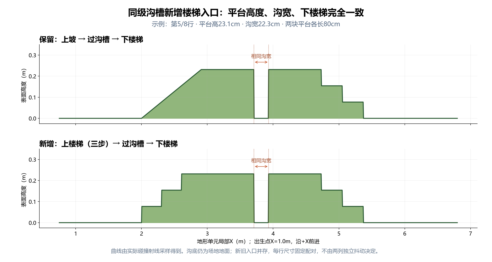
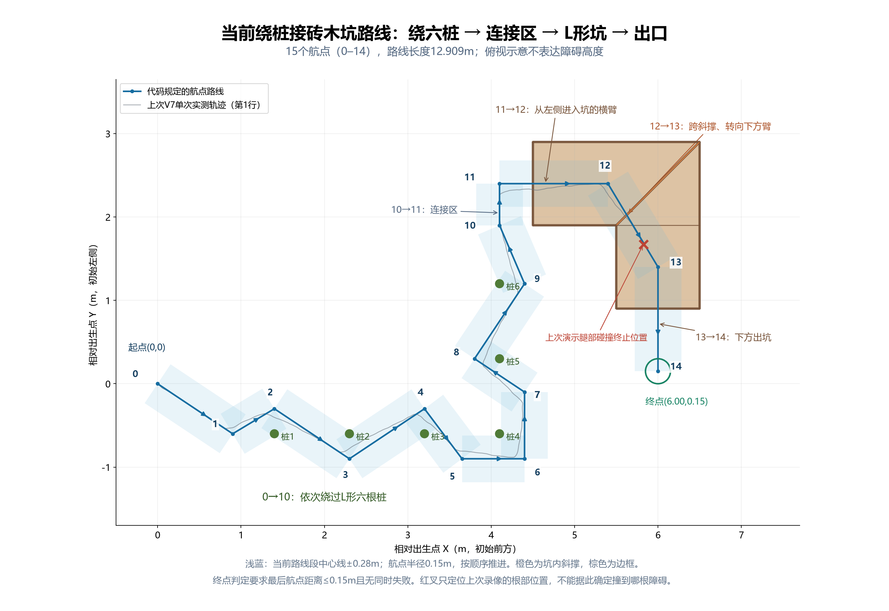

> 历史 V2 说明：已被 [课程 V3](MGDP_COURSE_V3.md) 修正。当前是同一区块内连续的两段过沟，10 类地形，高墙最高 35 cm；下面仅保留旧版本记录。

# 沟槽双入口、高墙10cm起与当前绕桩接坑路线

本次更新作用于当前新课程 `LgDog1-Race-MGDP-WallTraining`，工作台“MGDP · 高墙渐进课程”。日志实验名升级为 `lgdog1_velocity_race_mgdp_wall_v2`，避免与V1十类训练记录混用。旧V7的原任务 `LgDog1-Race-MGDP` 继续用于历史回放。

## 同一个难度下的两种沟槽

- `gap_steps`：保留“上坡 → 第一平台 → 过沟 → 第二平台 → 下楼梯”。
- `gap_stairs`：新增“上楼梯（三步）→ 第一平台 → 过沟 → 第二平台 → 下楼梯”。

两种同时参加训练、分别记录通过率。每一行使用相同的平台高度、沟宽、80cm平台长度、入口总长度及下降台阶尺寸，仅入口由坡面换成三步实心楼梯。两列原本会各自随机采样行内难度；现在对这两个变体固定到同一行的尺寸，保证“同一个难度”确实同尺寸。

| 地形行 | 平台高cm | 沟宽cm | 上楼梯每步高cm |
|---:|---:|---:|---:|
| 1 | 6.00 | 4.00 | 2.00 |
| 2 | 10.29 | 8.57 | 3.43 |
| 3 | 14.57 | 13.14 | 4.86 |
| 4 | 18.86 | 17.71 | 6.29 |
| 5 | 23.14 | 22.29 | 7.71 |
| 6 | 27.43 | 26.86 | 9.14 |
| 7 | 31.71 | 31.43 | 10.57 |
| 8 | 36.00 | 36.00 | 12.00 |

公式：内部行号r=0…7，d=r/7；平台高0.06+0.30d米，沟宽0.04+0.32d米，入口总长0.8+0.189092d米。上楼梯共3步、每步水平长度为入口总长/3；过沟后仍是两级32cm踏面，再落到地面。沟槽底保留原场地地面。

当前共11类地形，默认8×22地图（每类两列）。CLI/工作台最低列数改为11；继续填10列会报错，防止有地形没有分配到列。8行与难度倍率1固定，其他地形的行内随机性保留。

## 高墙默认从10cm开始

八阶段墙高为 **10、12、15、18、21、24、27、30cm**；对应墙数 **1、1、1、2、2、3、3、3**。第一行不再从2cm开始，墙厚8cm、位置和逐墙奖励判定沿用原实现。

新任务播放/目标验收在每一行都使用三道墙，并保留两种沟槽入口。V7历史任务的原赛道几何保持可复现；它的最低高墙并不代表当前V2课程默认值。

## 现在绕桩接砖木坑怎么走

路线本次没有改动。共有15个航点（0–14）、中心线长约 **12.909米**；坐标相对出生点，+X是初始前方，+Y是初始左侧。

1. **0→6：先绕四根横向排列的桩。** 四桩中心分别为(1.4,-0.6)、(2.3,-0.6)、(3.2,-0.6)、(4.1,-0.6)。路线交替从图上侧/下侧绕过，最后到(4.4,-0.9)。
2. **6→10：转向图上方，再绕另外两根桩。** 桩5、桩6中心为(4.1,0.3)、(4.1,1.2)；分别经过(3.8,0.3)、(4.4,1.2)，到(4.1,1.9)。
3. **10→12：走连接区，从坑左侧进入横臂。** 先到(4.1,2.4)，然后沿+X走到坑内(5.4,2.4)。
4. **12→13：斜向跨过坑内斜撑，进入下方竖臂。** 从(5.4,2.4)走向(6.0,1.4)。坑内有底板、碎块、边框与一根斜撑。
5. **13→14：沿图下方出坑。** 保持X=6.0，走向终点(6.0,0.15)。不是绕完六桩或进入坑内就算通过。

| 航点 | X/m | Y/m |
|---:|---:|---:|
| 0 | 0.00 | 0.00 |
| 1 | 0.90 | -0.60 |
| 2 | 1.40 | -0.30 |
| 3 | 2.30 | -0.90 |
| 4 | 3.20 | -0.30 |
| 5 | 3.65 | -0.90 |
| 6 | 4.40 | -0.90 |
| 7 | 4.40 | -0.10 |
| 8 | 3.80 | 0.30 |
| 9 | 4.40 | 1.20 |
| 10 | 4.10 | 1.90 |
| 11 | 4.10 | 2.40 |
| 12 | 5.40 | 2.40 |
| 13 | 6.00 | 1.40 |
| 14 | 6.00 | 0.15 |

距离当前航点≤15cm才推进下一点；中心线偏离超过28cm触发离线。最后航点距离≤15cm触发路线成功；若同时有触地、腿部严重/持续碰撞等失败，不算成功。指令随航点方向转动，并在靠近航点时按原算法减速。

图中灰线与红叉取自刚生成的V7第18200轮模型单次实测：它已进入L形坑，在12→13段触发腿部碰撞终止，没有到达最终出口。记录没有接触几何ID，不能据红叉断言撞的是哪根木条。

## 部署与模型迁移

本次补丁：`mgdp_course_v2_20261114.zip`，配合同名`.sha256`。上传两者到`/root`，以及`model_18200.pt`和配套感知文件；启动命令见 [高墙训练部署](MGDP_WALL_TRAINING.md)。

11类布局、沟槽几何和墙高契约已变化。V7与旧V1检查点迁入新V2使用 `--warm-start-checkpoint`，不能完整续训旧课程统计。新V2保存之后，才使用其自身检查点完整续训。感知与探索设置本次保持现有值；工程验证不等于GPU收敛或已通过10cm高墙。
