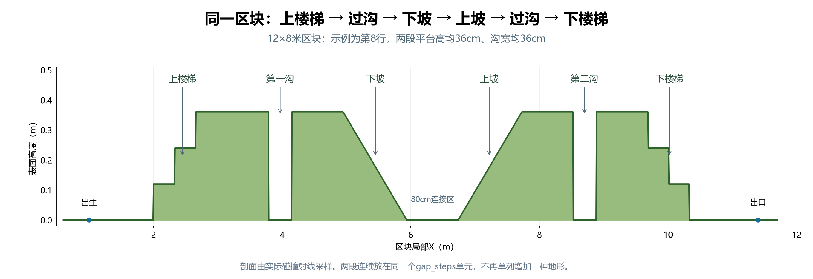
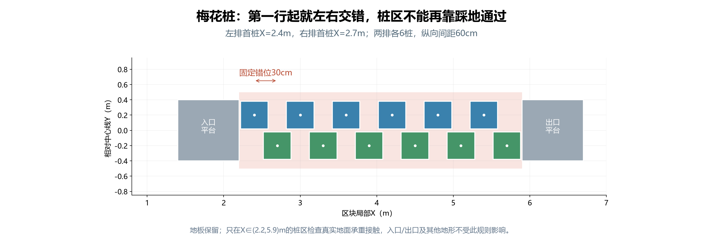
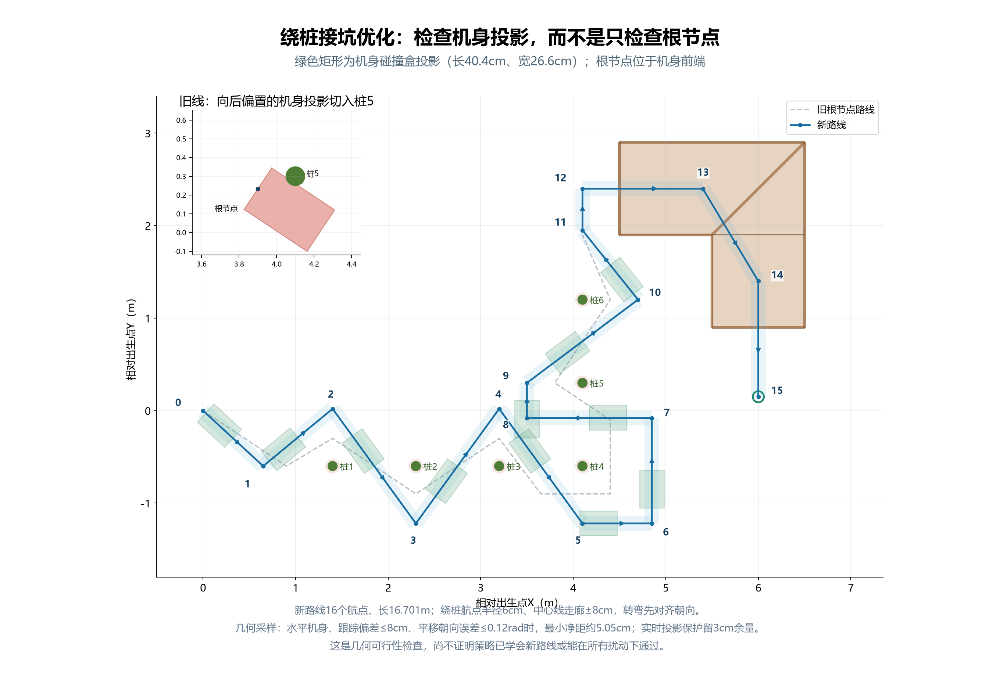

> 历史V3：当前已升级为 [统一八档课程V4](MGDP_COURSE_V4.md)，所有比赛障碍第6档为比赛尺寸，第7/8档强化。下面保留V3记录。

# MGDP 课程 V3：同区块过沟、10–35 cm 高墙与严格绕障

2026-11-15；当前新任务 `LgDog1-Race-MGDP-WallTraining`，实验名 `lgdog1_velocity_race_mgdp_wall_v3`。部署和迁移命令见 [训练说明](MGDP_WALL_TRAINING.md)。V2 将沟槽拆成两种地形的实现已撤出当前任务。

## 同一区块的两段过沟

**上楼梯 → 过沟 → 下坡 → 80 cm 平地 → 上坡 → 过沟 → 下楼梯**。

两段按顺序放进同一个 `gap_steps` 区块，仍只有 10 类地形。新任务默认 8 行×20 列、每类两列；至少 10 列。区块扩大到 12×8 m，使两段保持原有的高度、沟宽及平台长度。出生位置局部 X=1 m，出口 X=11.4 m；路线相对出生点长 10.4 m。

同一行的两段使用相同 H（平台高）、G（沟宽）和 L（坡长/上楼梯总长）。令内部行号 r=0…7，d=r/7：H=0.06+0.30d m，G=0.04+0.32d m，L=0.8+0.189092d m。每侧平台长 80 cm。

| 地形行 | 两段平台高 cm | 两段沟宽 cm | 上楼梯每步高 cm |
|---:|---:|---:|---:|
| 1 | 6.00 | 4.00 | 2.00 |
| 2 | 10.29 | 8.57 | 3.43 |
| 3 | 14.57 | 13.14 | 4.86 |
| 4 | 18.86 | 17.71 | 6.29 |
| 5 | 23.14 | 22.29 | 7.71 |
| 6 | 27.43 | 26.86 | 9.14 |
| 7 | 31.71 | 31.43 | 10.57 |
| 8 | 36.00 | 36.00 | 12.00 |

第一段从区块 X=2 m 开始，上楼梯三步后过沟，再沿实心斜坡下降；第二段经实心斜坡上升后过沟，沿两块 32 cm 深踏面逐级下降到地面。纵向复制九条相邻通道覆盖场宽。沟底仍为原地面，其他已有失败条件沿用。

## 高墙八档

高度精确为 **10、12、15、18、21、25、30、35 cm**。训练墙数依次为 **1、1、1、2、2、3、3、3**；每级播放验收均为三墙。保持每墙一次越墙奖励、局部摆腿净空和移动停滞检测。

## 为什么旧梅花桩能踩地，且前排没有错位

旧赛道的桩下是连续地板，没有“桩区足端踩地失败”规则。踩地仍可推进路线，因此策略可以利用地板。旧左右两排的纵向错位量为 `0.3 × difficulty` m，最低难度为零，前排自然对齐。

新任务使用 `StrictStonesTerrainCfg`：每一级左右两排均固定纵向错位 **30 cm**，同排间距 60 cm；左排首桩 X=2.4 m，右排首桩 X=2.7 m，每排六桩。入口平台 X=1.4…2.2 m，出口平台 X=5.9…6.7 m。

**2026-11-15 比赛尺寸及上限修正**：当前共 n=8 档，将 **第 n−2=6 档（内部等级5）固定为比赛尺寸**，最后两档继续提高难度。八档的桩面与高度均固定，不受行内随机采样影响：

| 显示档位 | 内部等级 | 桩面 cm | 桩高 cm | 横向净距 cm | 同排纵向净距 cm | 用途 |
|---:|---:|---:|---:|---:|---:|---|
| 1 | 0 | 36×36 | 2 | 4 | 24 | 入门 |
| 2 | 1 | 32×32 | 3 | 8 | 28 | 过渡 |
| 3 | 2 | 28×28 | 4 | 12 | 32 | 过渡 |
| 4 | 3 | 25×25 | 6 | 15 | 35 | 过渡 |
| 5 | 4 | 22×22 | 8 | 18 | 38 | 接近比赛 |
| **6** | **5** | **20×20** | **10** | **20** | **40** | **比赛尺寸** |
| 7 | 6 | 18×18 | 12 | 22 | 42 | 强化 |
| 8 | 7 | 16×16 | 15 | 24 | 44 | 强化 |

所有档保持同排中心距60 cm、两排横向中心距40 cm、两排纵向错位30 cm。入口和出口平台均80×80 cm，高度随本档桩高一致。第6档尺寸、间距及错位与项目随附 `src/assets/terrains/race_obstacle_2027.xml` 的梅花桩单元逐项对齐；第7/8档的桩更小、更高，中心距保持不变，净落脚间隙相应增大。

训练场仍将参考梅花桩单元重复加长为每排六桩，便于采集连续落脚；这里对齐的是障碍尺寸与间距，整幅训练地图不是比赛场地的完整布局复制。比赛能力验收应固定第6档单独多次评估，第7/8档的训练结果单独记录。新回归测试从随附 XML 读取尺寸，检查第6档不同随机输入所生成的实际 MuJoCo 几何一致，同时检查后两档确实更难。详见 [扩展课程验证](MGDP_STONES_EXTENDED_VALIDATION.json)。

地板保留，在桩区局部 **X∈(2.2,5.9) m** 内检测真实足端承重地面接触。触发要求：有效接触、力 ≥1 N、法线 |Z|>0.7、接触点高度 ≤8 mm。传感器保留每步四个物理子步的接触点、法线和有效标记，避免最后一个子步离地掩盖前面的踩地。入口/出口地面允许使用，腾空足端不会误判为踩地。训练和播放使用同一规则。单纯脚尖轻触且低于 1 N 不计为承重落脚。

这会改变学习目标，需要迁移策略后重新训练；旧模型不会自动具备踩桩能力。

## 绕桩接坑：身体投影与新路线

机器人根节点在躯干前端，躯干碰撞盒中心在其后 20.2 cm；碰撞盒长 40.4 cm、宽 26.6 cm。旧路线只用根节点引导，转向时向后伸出的身体可能扫过柱子。旧路线几何采样在第五根桩附近得到最小间隙 **−1.66 cm**，即已有投影重叠。

桩和坑的物理位置不变，只在新任务替换路线：先绕过前四桩，向右侧空地拉开，折返经过第五桩下方，再从第六桩右侧绕到坑区，穿过坑区后从右侧下降至出口。新路线有 16 个航点、总长 **16.7009 m**。

绕桩列的中心线走廊半宽收为 **8 cm**、到点半径 **6 cm**，航向误差超过 **0.12 rad（约 6.9°）** 时先将 XY 指令置零，对齐后再移动，减少转向时扫桩。其他地形的原走廊和到点半径不受此项调整。

新失败项 `slalom_body_projection` 读取躯干碰撞盒实际位置和旋转，计算含俯仰/横滚的水平投影到柱心的距离，使用保守柱半径 5 cm，要求柱边另留 **3 cm**。这样即使矮柱没有碰到高处的躯干，也不会接受水平投影压住桩子的动作；腿部碰撞仍由原规则检查。

采样校验涵盖 31,176 个水平机身姿态：平移路径根点偏差半径 8 cm、航向误差 ±0.12 rad，转向点根位置偏差半径 6 cm 并扫描全部朝向。最小柱边间隙 **5.047 cm**。这是上述范围内的离散几何校验，不是所有连续姿态的证明，也不是训练后策略验收；实际投影终止仍会检查运行中的机身姿态。数据见 [几何记录](analysis/course_v3/route_geometry_check.json)。

航点坐标相对出生点，单位 m；桩区中心 Y=0：

| 航点 | X | Y |
|---:|---:|---:|
| 0 | 0.0 | 0.0 |
| 1 | 0.65 | -0.6 |
| 2 | 1.4 | 0.02 |
| 3 | 2.3 | -1.22 |
| 4 | 3.2 | 0.02 |
| 5 | 4.1 | -1.22 |
| 6 | 4.85 | -1.22 |
| 7 | 4.85 | -0.08 |
| 8 | 3.5 | -0.08 |
| 9 | 3.5 | 0.3 |
| 10 | 4.7 | 1.2 |
| 11 | 4.1 | 1.95 |
| 12 | 4.1 | 2.4 |
| 13 | 5.4 | 2.4 |
| 14 | 6.0 | 1.4 |
| 15 | 6.0 | 0.15 |

可下载 [航点 CSV](analysis/course_v3/slalom_waypoints.csv)。坑内原有边条、斜条和填充块保留，路线不代表可以忽略足端或腿部接触。

## 兼容、迁移与验证边界

原 `LgDog1-Race-MGDP` 的地形尺寸、梅花桩错位、落脚规则和路线保留，旧 V7 可以按原设置回放。V3 有独立实验名和课程契约；旧 V7/V1/V2 以及本次八档修正前的 V3 模型必须 actor warm-start，不能完整续训旧课程状态。回合总时限为 120 秒，指令重采样为 121 秒，覆盖长组合路段和绕桩转向。

此前 V3 本地回归 **370 项通过、5 项跳过，127 项子测试通过**。另以 V7 第 18200 轮模型和匹配感知在 CPU 的 10 环境、8×10 地图执行两轮 PPO、保存、ONNX/JIT 导出，再从新检查点完整续训一轮；检查通过。传感器与投影失败项均实际构建。记录见 [V3 验证 JSON](MGDP_COURSE_V3_VALIDATION.json)。

本地没有执行 GPU 训练，不能据此确认 8192 环境的峰值显存、CUDA 运行性能、长期收敛、35 cm 高墙能力或新路线实际通过率。建议先跑 64 环境三轮 GPU 工程检查，再开启正式训练，并用固定难度多次验收。

本次梅花桩八档修正回归 **372 项通过、5 项跳过、127 项子测试通过**；另重新执行当前版本的 CPU 两轮策略迁移训练、导出及一轮完整续训，通过。以第6档对照随附比赛XML、最后两档继续强化；GPU学习效果仍待验收。记录见 [扩展课程验证](MGDP_STONES_EXTENDED_VALIDATION.json)。
