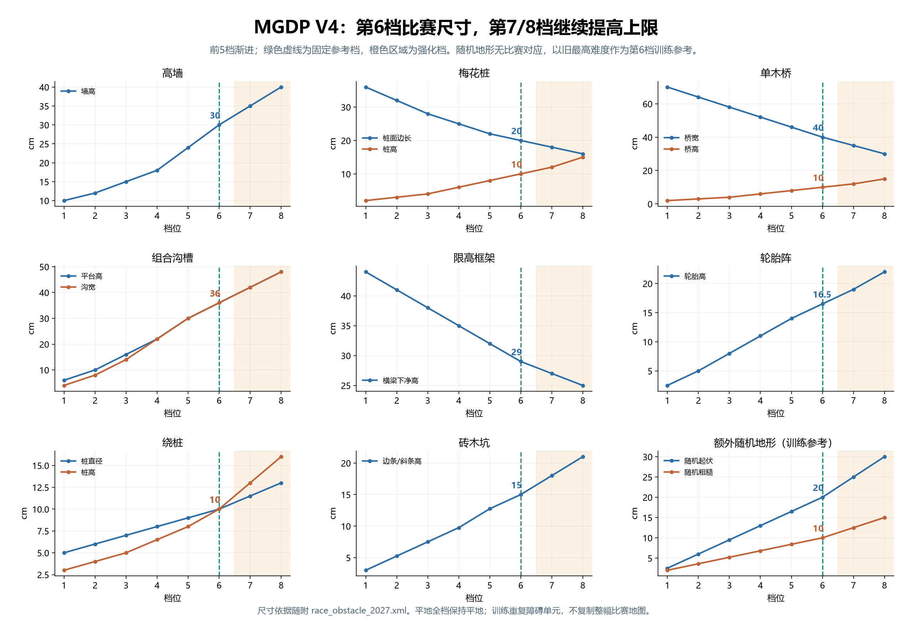
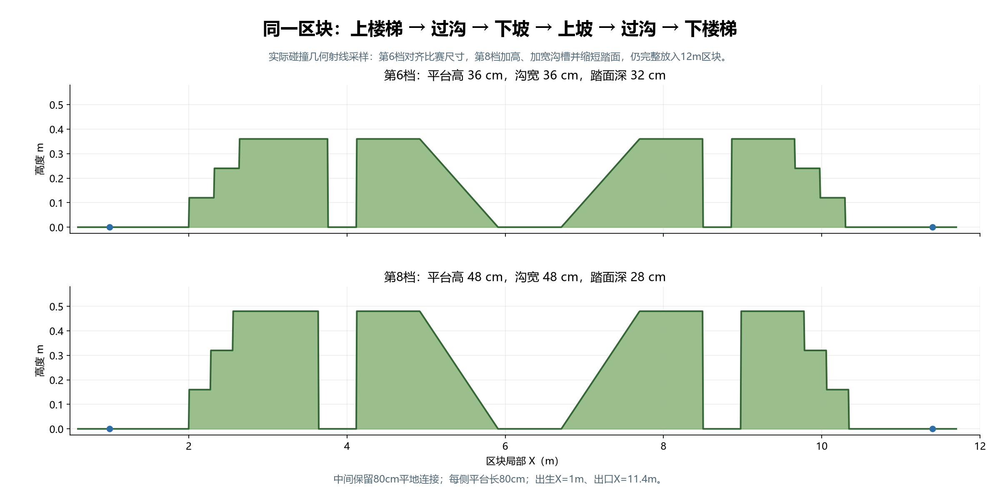

> V4尺寸表继续用于当前V5；当前实验与高墙奖励已升级，见 [V5高墙防刷分](MGDP_WALL_PROGRESS_GUARD.md)。

# MGDP 统一八档课程 V4（2026-11-15）

任务 `LgDog1-Race-MGDP-WallTraining`，工作台“MGDP · 比赛尺寸强化课程”，实验目录 `logs/rsl_rl/lgdog1_velocity_race_mgdp_wall_v4/`。当前规则是 **前5档渐进，第n−2=6档固定比赛尺寸，第7/8档强化**。8行×20列、10类地形、区块12×8 m、回合120秒、指令重采样121秒。部署命令见 [训练说明](MGDP_WALL_TRAINING.md)。

尺寸依据项目随附 `src/assets/terrains/race_obstacle_2027.xml`，并通过实际生成的 MuJoCo 几何对照。这里对齐的是比赛障碍单元的尺寸和间距；训练仍横向铺设、纵向重复障碍，整幅地图不是比赛场地的完整布局复制。第6档作为比赛能力验收档，第7/8档成绩单独记录。

## 比赛档与强化档

| 障碍 | 第6档：比赛尺寸 | 第7档 | 第8档 |
|---|---|---|---|
| 梅花桩 | 桩面20×20cm，高10cm | 18×18cm，高12cm | 16×16cm，高15cm |
| 单木桥 | 长3m，宽40cm，高10cm | 宽35cm，高12cm | 宽30cm，高15cm |
| 组合沟槽 | 平台高36cm，沟宽36cm，台阶高12cm/深32cm，坡约20° | 平台42cm，沟42cm，台阶14cm/30cm，坡约23° | 平台48cm，沟48cm，台阶16cm/28cm，坡约26° |
| 高墙 | 高30cm，厚8cm，单墙宽80cm | 高35cm | 高40cm |
| 限高框架 | 内宽80cm，横梁下净高29cm | 净高27cm | 净高25cm |
| 轮胎阵 | 外径约55cm、内径约33cm、高16.5cm，中心距55cm | 高19cm | 高22cm |
| 绕桩 | 桩径10cm、高10cm、中心距90cm | 桩径11.5cm、高13cm | 桩径13cm、高16cm |
| 砖木坑（与绕桩同列） | L形2×2m、底板3cm、边条/斜条高15cm，复制比赛模型全部填充块 | 竖向整体×1.2，边条18cm | 竖向整体×1.4，边条21cm |

轮胎使用比赛模型的48片凸扇区网格，保留真实环形孔洞；练习阵列为每行4胎、横向重复双排单元。砖木坑第6档直接复制参考模型中的全部实体方块及其旋转，不再使用原先的稀疏大块近似。它们的几何数量增加，GPU峰值显存和吞吐需要重新测量。

绕桩桩心及身体安全路线不变。投影失败检测按每个环境的当前档位读取实际桩半径，第8档不会继续按5cm半径判断。最大6.5cm半径下，指定跟踪误差范围内离散几何采样的最小桩边间隙约3.55cm；运行中仍要求至少3cm。几何可行不表示策略已经学会通过。

## 八档完整参数

同一档的主要尺寸固定，不随行内随机难度变化；随机地形的具体表面仍按种子变化。

| 档位 | 梅花桩边长/高cm | 单木桥宽/高cm | 平台高/沟宽cm | 高墙高cm | 限高净高cm | 轮胎高cm | 绕桩直径/高cm | 坑竖向倍率 |
|---:|---|---|---|---:|---:|---:|---|---:|
| 1 | 36 / 2 | 70 / 2 | 6 / 4 | 10 | 44 | 2.5 | 5 / 3 | 0.20 |
| 2 | 32 / 3 | 64 / 3 | 10 / 8 | 12 | 41 | 5 | 6 / 4 | 0.35 |
| 3 | 28 / 4 | 58 / 4 | 16 / 14 | 15 | 38 | 8 | 7 / 5 | 0.50 |
| 4 | 25 / 6 | 52 / 6 | 22 / 22 | 18 | 35 | 11 | 8 / 6.5 | 0.65 |
| 5 | 22 / 8 | 46 / 8 | 30 / 30 | 24 | 32 | 14 | 9 / 8 | 0.85 |
| **6** | **20 / 10** | **40 / 10** | **36 / 36** | **30** | **29** | **16.5** | **10 / 10** | **1.00** |
| 7 | 18 / 12 | 35 / 12 | 42 / 42 | 35 | 27 | 19 | 11.5 / 13 | 1.20 |
| 8 | 16 / 15 | 30 / 15 | 48 / 48 | 40 | 25 | 22 | 13 / 16 | 1.40 |

梅花桩全档同排中心距60cm、横向中心距40cm、纵向错位30cm，入口/出口平台80×80cm，高度与本档桩高一致；桩变小后净间隙增大。桩区承重踩地失败规则保留。

组合沟槽仍在同一区块连续放置：**上楼梯→过沟→下坡→80cm平地→上坡→过沟→下楼梯**。两段每一档使用相同平台高度和沟宽。前6档踏面深32cm，后两档为30/28cm；第6档坡长使用XML中的0.989092m，之后保持坡长、增加高度。未缩短平台或改变既定流程。

高墙训练墙数为1/1/1/2/2/3/3/3，第6档及以上都必须完成三墙路线才算通过；播放验收所有档均三墙。保留4秒无新增5cm进展失败、每道墙一次奖励和墙附近摆腿净空辅助。高墙最高从此前35cm提高到40cm，使30cm比赛尺寸落在第6档。

## 随机地形和平地

`random_hills`（随机起伏）与 `mjlab_rough`（随机粗糙）是额外训练地形，在比赛XML中没有对应单元，不能称为比赛尺寸。它们第6档使用此前最高档参考幅度：随机起伏20cm、随机粗糙10cm；第7档为25/12.5cm，第8档为30/15cm。前5档按原生成器渐进，入口/出口平缓区保留。

平地是无障碍练习区，全档保持平地，不人为增加障碍。

## 迁移和验收边界

这是V4课程契约，原V7、V1–V3及之前梅花桩扩展版模型都通过 `--warm-start-checkpoint` 迁移actor；critic、优化器和课程窗口重新开始。不能完整续训旧课程并保留它的通过统计。V4自身检查点之后可以完整续训。

冻结感知和现有速度门控保持不变，速度仍从0.25–0.35m/s开始。各列的课程通过窗口会包含不同难度，不能用混合窗口成绩代表固定第6档比赛通过率。比赛能力需要固定第6档、多次评估，记录实际速度、成功数和失败原因；第7/8档是否可学习也需要训练验证。

本地回归、CPU迁移训练/保存/导出/完整续训及几何采样结果见 [V4验证记录](MGDP_COURSE_V4_VALIDATION.json)。本地未执行GPU长期训练，不能据工程检查确认收敛、8192环境显存或最高档通过能力。

最终本地回归 **380项通过、5项跳过、127项子测试通过**；第18200轮策略和匹配感知向V4的CPU两轮PPO迁移训练、保存、ONNX/JIT导出，以及新检查点一轮完整续训通过。最大桩径13cm的路线采样最小间隙3.547cm。GPU收敛、吞吐及峰值显存尚未验证。
