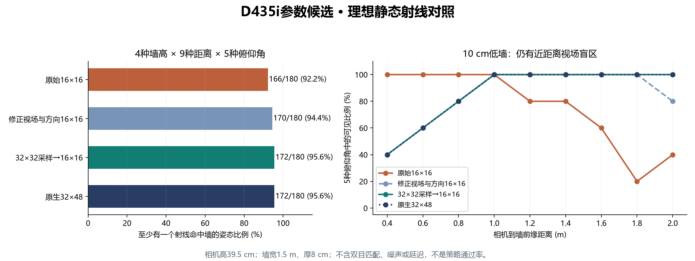

# MGDP：D435i深度与探索参数候选（2026-11-15）

本次新增可选配置，现有任务与旧模型仍用原16×16约定。新配置是实验起点，并未在真实D435i或GPU长训上验证。

## 为什么先修正输入约定

原代码 `DEPTH_FOVY=87` 用的是垂直87°，正方形图像水平方向也是87°。D435i深度相机标称水平87°、垂直58°，不是垂直87°。现有相机site旋转把射线局部X映射到机身上方，因此原张量的宽方向实际上对应上下；新配置改成正立、逐行排列的相机图像。RealSense给的是光轴Z深度，原代码用的是射线欧氏距离；新配置先投影到光轴Z。

这些变化会改变冻结编码器看到的分布，不能直接套原感知权重或旧策略。新配置需要重新预训练感知并新建策略训练；现有warm-start仍严格要求同一个感知编码器。只做探索对照时，可以在原相机/原编码器下迁移旧actor。

## 建议参数

| 参数 | 先试的设置 | 说明 |
|---|---|---|
| 实机采集 | Z16、848×480、30 FPS | 官方推荐的基准；0.35 m/s先用它 |
| 较快运动对照 | 848×480、60 FPS | 工程候选，需验证USB带宽、曝光、丢帧和端到端延迟；不是官方最优值 |
| 视场 | H87°、V58° | 新仿真配置为标称值；实机必须读取所选流的fx/fy/cx/cy并实测外参 |
| 仿真编码范围 | 0.2–3.0 m，按3 m归一化 | 本地越障候选，不是相机全量程；超范围/无效值保持远值 |
| 像素缩减 | 最近有效深度池化 | 保护小前景；零、NaN、Inf不能当作最近点；会放大近物及孤立近噪点，需实机对照 |
| 时域滤波/持久填洞 | 先关闭 | 避免移动时拖影和历史深度滞留 |
| 空洞填补 | 先关闭 | 防止填平沟槽、改变薄墙边缘 |
| 视觉预设 | 先Default，对照High Density | 高密度可能补足边缘也可能引入噪点；High Accuracy降低填充率，并非一定更好 |
| 曝光 | 先自动曝光并记录实际值 | 更快运动时在充足光照下对照4–8 ms手动曝光；这是待验证起点，勿无条件照搬 |
| 相机安装 | 保持已测外参 | 不先统一向下转15°；俯角能改善近地盲区，也可能损失限高框上沿 |
| PPO探索对照 | entropy_coef=0.003，初始std=0.30 | 研究候选；0.30是初始值，不是训练期间的下限 |

当前空间采样配置仍每控制步更新，沿用50 Hz控制；**尚未模拟实机30/60 FPS异步到帧、延迟或运动模糊**。真实部署还需用时间戳验证输入帧龄，不能仅凭静态射线结果认定sim2real匹配。

## 已实现的两个配置

- `d435i_edge16`：32×32=1024条射线，2×2最近有效深度→16×16；射线数为原4倍，编码器输入像素数不增加。建议先试此方案。
- `d435i_native32`：32×48=1536条射线，直接输入32×48；射线和编码器像素数均为原6倍。暂不作为默认，需GPU显存/吞吐实测。

`src/mgdp_depth.py`集中定义视场、像素顺序、光轴深度及缩减规则。真实相机Z16先乘设备的`get_depth_scale()`得到米，再调用`reduce_z_depth(depth_m, profile)`；不能把uint16原始单位直接传入。函数也返回有效性掩码；当前策略输入仍保持原两帧深度，未增加掩码通道。该函数是预处理工具，本项目尚未接通真实相机流。

`train.py --depth-profile`、感知预训练、CPU MuJoCo回放、编码器指纹及完整续训均已接入相同空间约定。旧编码器的指纹算法保持原结果；新编码器与策略记录camera契约，恢复时自动还原且拒绝混用。

## 静态对照结果的边界



固定相机高39.5 cm、墙宽1.5 m/厚8 cm，比较4种墙高（10/18/30/40 cm）、9种距离（0.4–2 m）和5种俯仰（−10/−5/0/5/10°），每方案180种姿态。原始方案166/180可见；修正视场、方向和像素中心后的16×16是170/180；edge16和native32均172/180。该指标只要求至少一条射线碰墙，不代表编码器正确辨识，更不是策略通过率。

**本夹具在1.2 m、俯仰0°时原16×16也能命中墙，未复现原场景的漏检。** 原报告的具体墙高、相机姿态、遮挡和像素相位仍需原场景复测，不能把“1.2米漏墙”当成所有姿态下的事实。墙沿前进方向厚8 cm本身不能决定是否漏检，正面高度与投影也关键。修正后的16×16一次改变了视场、方向和像素中心，不能分开归因；edge16相对它再增加采样密度。

## 部署和使用命令

累计补丁`E:/算力自由/mgdp_d435i_candidates_20261115.zip`包含之前的高墙规则工作台和V5课程。上传zip及同名`.sha256`到服务器后：

```bash
cd /root
sha256sum -c mgdp_d435i_candidates_20261115.zip.sha256 && unzip -o mgdp_d435i_candidates_20261115.zip -d /root
cd /root/unitree_rl_mjlab_lgdog
conda activate /root/lgdog
source server_env.sh
lgdog_server_env "$PWD"
```


先在GPU上为新空间约定预训练感知，保留8行课程，十类障碍都采集：

```bash
python -u -m scripts.pretrain_mgdp \
  --task LgDog1-Race-MGDP-WallTraining --depth-profile d435i_edge16 \
  --device cuda:0 --num-envs 64 --terrain-rows 8 --terrain-cols 10 \
  --sequence-length 8 --steps 3000 --iterations 3000 --batch-size 64 \
  --seed 42 --out logs/mgdp/perception/d435i_edge16_seed42.pt
```

新感知搭配新策略，先64环境、5轮检查工程流程：

```bash
python -u -m scripts.train LgDog1-Race-MGDP-WallTraining \
  --depth-profile=d435i_edge16 \
  --perception-checkpoint=logs/mgdp/perception/d435i_edge16_seed42.pt \
  --env.scene.num-envs=64 --terrain-num-rows=8 --terrain-num-cols=10 \
  --agent.experiment-name=lgdog1_mgdp_d435i_ab --agent.run-name=edge16_smoke \
  --agent.max-iterations=5 --agent.algorithm.entropy-coef=0.003 \
  --exploration-std=0.30
```

通过后才逐档增加环境数并记录峰值显存和采样吞吐。4倍射线不等于4倍总耗时，也不保证速度不下降。

如果先验证探索，不更换原相机/编码器：在原来已经可用的V5策略迁移命令后增加`--agent.algorithm.entropy-coef=0.003 --exploration-std=0.30`，不要加`--depth-profile`。显式std会在actor加载后重设，避免被旧检查点的0.11–0.19覆盖。该参数禁止与完整`--agent.resume=True`合用，以免悄悄改写优化器续训状态。后续完整续训需重复原实验的PPO参数（如`--agent.algorithm.entropy-coef=0.003`），相机配置会从检查点恢复；不要再传`--exploration-std`。

对照顺序：先固定相机/编码器，只改探索；随后固定PPO超参数和初始std，对比旧空间约定与edge16，双方策略均从相同随机种子重新训练，感知分别配套预训练。高墙10/12/15/18 cm分开验收，记录固定指令下通过率、站墙前时间、首次可见距离、至少2个有效像素持续帧数、无效深度率及GPU吞吐。至少3个种子，比较相同环境交互步数，同时比较相同墙钟时间。更多可见射线并不能证明学会越墙。

原始记录：[visibility.json](analysis/mgdp_d435i/visibility.json)、[逐姿态CSV](analysis/mgdp_d435i/visibility.csv)。`python -m scripts.check_mgdp_camera`可重跑静态夹具。工程验证见`MGDP_D435I_VALIDATION.json`。

## 官方依据

- [D435i规格与87°×58°标称深度视场](https://www.realsenseai.com/products/depth-camera-d435i/)
- [官方调优方法：优先848×480再降采样](https://dev.realsenseai.com/docs/tuning-depth-cameras-for-best-performance/)
- [视觉预设、30 FPS/自动曝光基准及填充率权衡](https://dev.realsenseai.com/docs/d400-series-visual-presets/)
- [滤波器：时域拖影、静态适用性与空间滤波范围](https://dev.realsenseai.com/docs/post-processing-filters/)
- [RealSense深度为光轴Z分量](https://dev.realsenseai.com/docs/projection-texture-mapping-and-occlusion-with-intel-realsense-depth-cameras/)

60 FPS、0.2–3 m、最近有效池化、曝光对照范围及PPO数值是本项目的待验证建议，不能归为厂商保证的最优参数。

## 工程验证记录

402项分组测试通过、5项跳过、135项子测试通过。CPU十环境高墙夹具完成12步感知数据采集、1次感知训练、1轮新策略PPO、完整续训、策略迁移和ONNX/JIT导出；相机契约自动还原通过，并另外验证了相同entropy_coef的续训。32×48矩形编码器的反向传播与64维特征输出通过。原V5配套编码器指纹仍为`7da635cf4a664d5ede1a876944c6af3a79d3b8ce746ab13e6306eafa0c65e3bb`。这些是工程流程检查，不证明GPU训练速度或越墙策略提升。
