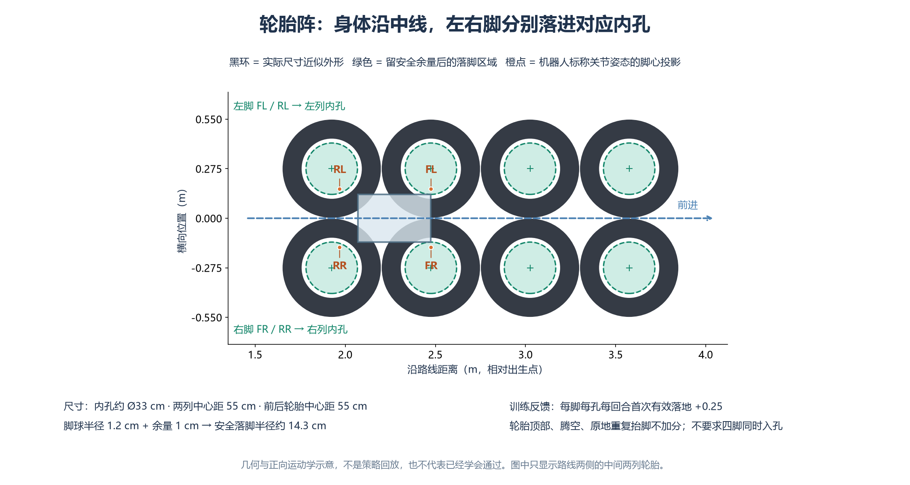

# 轮胎阵内孔落脚引导

目标：身体沿原中线前进，左前/左后脚优先落进左侧轮胎内孔，右前/右后脚优先落进右侧内孔。不要求四脚同时入孔，不要求每一步精准踩中心，也不增加漏踩即失败的终止条件。

原课程只有身体路线、一般步态与通过奖励，没有单独区分脚落在轮胎内孔、轮胎顶部还是其他位置。新增项是训练时的落脚偏好，不能让旧模型在打开开关后立即改变动作。



图来自当前模型尺寸与正向运动学，不是策略回放。课程横向重复轮胎用于并行训练，图只显示路线两侧中间两列。

## 几何与奖励

| 项目 | 当前实现 |
| --- | --- |
| 布局 | 两侧中心距55厘米，前后中心距55厘米，每侧4个目标内孔 |
| 内孔 | 直径约33厘米，按扇形碰撞网格的内边界半径0.164647米保守计算 |
| 脚碰撞体 | 每只脚球半径0.012米，从已编译模型读取并核验球体类型 |
| 安全余量 | 额外0.01米，脚心允许半径0.142647米，避免靠孔边也拿满奖励 |
| 有效落脚 | 对应脚真实承重接触地面，力至少1N、接触法线接近竖直、接触高度距出生地面不超过0.008米，并落在对应内孔安全区 |
| 每次奖励 | +0.25分，按事件发放，经过奖励管理器dt缩放后仍为0.25 |
| 去重 | 每只脚、每个孔、每回合只奖励一次；最多16次，总计4分 |
| 无奖励情况 | 腾空经过、轮胎顶部或侧面接触、对应侧之外的孔、入场/出场地面、原地站住、反复踩同一孔、保持支撑滑进下一个孔、同时失败或越界 |
| 时间分辨率 | 使用已有接触传感器各物理子步历史，保留控制周期内短暂触地 |

不改摄像头、感知输入、轮胎尺寸、原身体路线、速度设置或工作台保存的高墙奖励。D435i20配套感知模型可继续使用。

## 工作台与命令

支持“比赛尺寸强化课程”和“比赛尺寸强化课程 · D435i下俯20°”。重启工作台Python后端、刷新网页，在训练设置勾选 **轮胎内孔落脚引导（新训练可选）**。默认不勾选，便于保留旧实验和做有无引导的对照。

CLI在原训练命令上追加：

```bash
--tire-hole-guidance=True
```

已经运行的训练不会热更新。改变开关后须新建实验；迁移同相机配置的旧策略时使用 `--warm-start-checkpoint /path/to/model.pt`，不要同时完整续训。完整续训必须与检查点保持相同开关与奖励契约。新增目标会改变课程指纹，旧统计、critic和优化器不能当成同一实验继续。

模型检查点保存 `infos.mgdp_tire_hole_guidance`，ONNX保存同名元数据。Play会从模型自动恢复这个设置；它只恢复评估记录与奖励项，不改变策略输入或替策略规划脚步。

## 记录与验收

TensorBoard：

- `Episode_Reward/tire_hole_touchdown`：遵循原奖励管理器口径，为回合累计奖励除以最大回合秒数，并非每次触地的分数。
- `Episode_Metrics/tire_hole_new_landings_per_step`：每控制步新增有效内孔落脚数。
- `Episode_Metrics/tire_field_touchdowns_per_step`：轮胎区域内每控制步的承重触地次数，包括未踩进孔的尝试。

两个Metrics均按回合步数取平均，其他地形贡献零，因此不能直接当作轮胎专属成功率。前者还做了每脚每孔去重，不能直接除以后者声称为纯粹命中率。应配合轮胎专项回放、接触点和通过率看效果。

工程验证覆盖八档真实内孔网格、左右脚对应、去重、短时触地、支撑滑移、失败过滤、部分重置、工作台到CLI及续训契约。GPU收敛、1m/s过胎、实物表现均需后续训练验证。

复现示意图：`python -m scripts.plot_tire_hole_guidance`。

主要实现：`src/tasks/velocity/mdp/tire_training.py`；配置入口：`src/config/tire_guidance.py`。

本次相关回归99项、34个子测试通过。CPU集成验证使用2环境、8×1轮胎专项小场景，为控制编译开销仅保留中间两列轮胎；完成1次PPO更新、1次完整续训更新、1次旧策略迁移更新，并核验检查点/ONNX的引导契约与固定巡航记录。正式课程地形未裁剪，完整八档网格另有射线测试。详细记录见 `MGDP_TIRE_HOLE_VALIDATION.json`。
