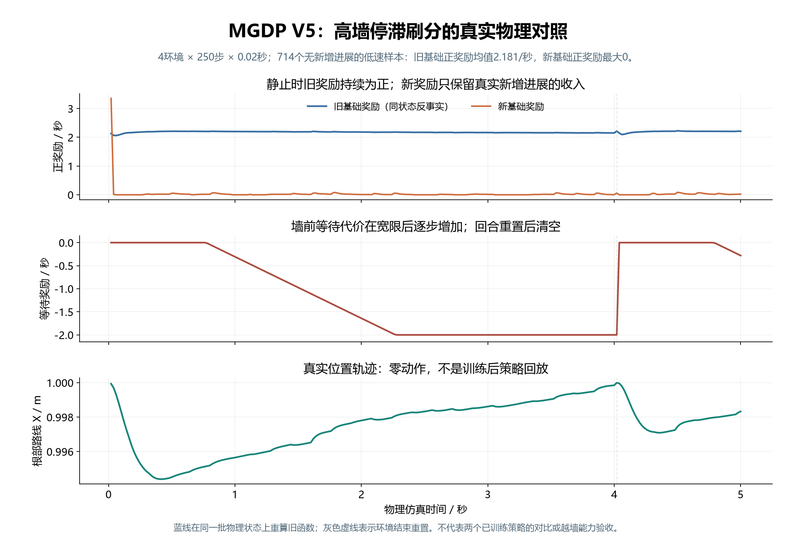

# 高墙停滞刷分修正 V5（2026-11-15）

任务 `LgDog1-Race-MGDP-WallTraining`，工作台“MGDP · 比赛尺寸强化课程”，新实验 `lgdog1_velocity_race_mgdp_wall_v5`。V4的全部八档尺寸、同区块双段过沟、梅花桩落脚和绕桩身体投影规则保留。尺寸见 [V4参数表](MGDP_COURSE_V4.md)，部署见 [训练说明](MGDP_WALL_TRAINING.md)。

## 确认的问题

原来的 `ForwardProgress` 已按最远路线位置奖励新增距离，`WallCrossingBonus` 已要求四脚越过且每墙只发一次，4秒无进展终止也已经接入。因此，不能把漏洞简单归结为“没有距离奖励”。

缺口在基础正奖励：机器人即使不前进，指数速度跟踪仍可为正，零转向和保持姿态也可以得分；原地抬脚还可能获得腾空奖励。4秒停滞前仍有这些收入。不能仅根据本地验证断言用户某个已训练检查点必然采用了该策略，但这个奖励漏洞可以被直接复现。

CPU真实物理零动作检查：4环境、250控制步、每步0.02秒，出生在路线前进1m、低墙前方。在714个“低速、无新增最远进展、未重置”的环境状态样本中，旧基础正奖励的同状态反事实均值为 **2.18084分/秒**；新基础正奖励最大值为 **0**。这是原奖励函数在同一批状态上的反事实对照，不是两个已训练策略的效果比较，也没有证明高墙通过率提高。



原始 [CSV](analysis/wall_guard/physical_check.csv)、[物理检查JSON](analysis/wall_guard/physical_check.json)。

## 新规则

1. **基础正奖励随真实新增距离发放**：仅高墙列且XY移动指令≥0.1m/s时，对线速度跟踪、角速度跟踪、姿态、步态和腾空奖励的正值使用门控：`g=clip(新增最远路线距离/(0.1m/s×控制步长),0,1)`。不动、后退、回到旧位置都没有新的这类收入；前进达到0.1m/s时门控不削减原分数。最远距离按回合记录，不按上一帧位移计算，来回摆动不能持续刷分。初始化和局部重置不会把出生位置当进度发奖。
2. **保留安全代价**：各基础权重和原函数参数不变，负值不被门控吞掉。非高墙列返回原基础奖励；绕桩原地对齐不受这个高墙规则影响。未启用的步态奖励也预先接入门控，之后调高权重不会绕过规则。
3. **靠墙等待递增代价**：只针对下一道尚未完全越过的有效墙，根部进入墙心前75cm范围且有移动指令时计时；真实最远进展新增2cm刷新等待。使用根部和最后脚位置的较小进展，避免只伸长身体刷新。前0.75秒保留准备时间，此后1.5秒内线性增加至每秒扣2分，达到上限后不再无限放大。完整越过该墙后切换到下一道墙；其他地形、停站指令和已完成墙不扣此项。
4. **原距离和事件奖励保留**：`passage_progress`仍按新增路线距离发奖；每墙四脚与根部满足原越墙条件后+2，每回合一次；到最终出口+5。靠近墙的真实进展可以获得有限引导，站住不能持续领取这些距离/事件奖励。
5. **4秒停滞失败保留**：4秒内没有新增累计5cm最远路线进展就结束回合。等待代价不是替代这个终止条件，两者分别作用。

等待函数返回的是每秒代价率，由RewardManager乘控制步长一次。静止等待4秒的额外代价约−5分，另加原失败代价。0.01和0.02秒控制步长的积分回归结果一致。时间和代价参数是当前初始设置，是否影响正常越墙准备以及能否改善学习，需要GPU训练轨迹验收。

## 使用和检查

这次奖励目标改变，V4及更早检查点需要 `--warm-start-checkpoint` 迁移actor，不能完整恢复旧critic、优化器和课程窗口。命令与完整参数见训练说明。新检查点的指令契约中记录 `wall_reward_contract_version=1`，参与原课程指纹校验；V5自己的后续检查点可完整续训。

上传补丁后，可先执行无需感知文件的物理奖励检查：

```bash
python -u -m scripts.check_mgdp_wall_rewards --device cuda:0 --envs 64 --steps 250 \
  --output .artifacts/mgdp-wall-rewards/gpu_check.json
```

这个检查使用低墙专项布局和零动作，旧分数在新物理轨迹同状态计算。它用于检查奖励漏洞，不用于判断策略会不会越墙，也不代表完整10类地图的显存或速度。

观察 `Episode_Reward/wall_waiting`、各基础奖励、`wall_crossing`、`Episode_Termination/no_passage_progress`，并结合根部最远前进距离、四脚越墙和独立成功率。训练曲线中的基础奖励定义已经变化，应使用V5新实验目录，不能把它与V4直接当同一指标比较。

本地工程和物理对照见 [验证记录](MGDP_WALL_GUARD_VALIDATION.json)。高墙专项CPU的策略迁移、两轮PPO、保存、ONNX/JIT导出及一轮完整续训通过；完整10类几何沿用已验证V4，非墙奖励由混合地形回归检查。GPU长期收敛与新策略越墙能力尚未验证。

最终分组回归 **387项通过、5项跳过、128项子测试通过**。5秒零动作轨迹中，平均每环境新基础正奖励与等待代价之和为 -4.894 分（未计其余原有代价和失败代价）；这进一步区分了有限的真实微小进展收入与持续停滞刷分。

验证环境记录：单进程全量运行的1项工作台HTTP测试两次遇到Windows连接中止10053；该用例独立复测通过，整个工作台模块单独进程20项通过，其余模块另一个进程367项通过。未改动HTTP服务器逻辑来掩盖该异常；上述总数为分组执行结果。
