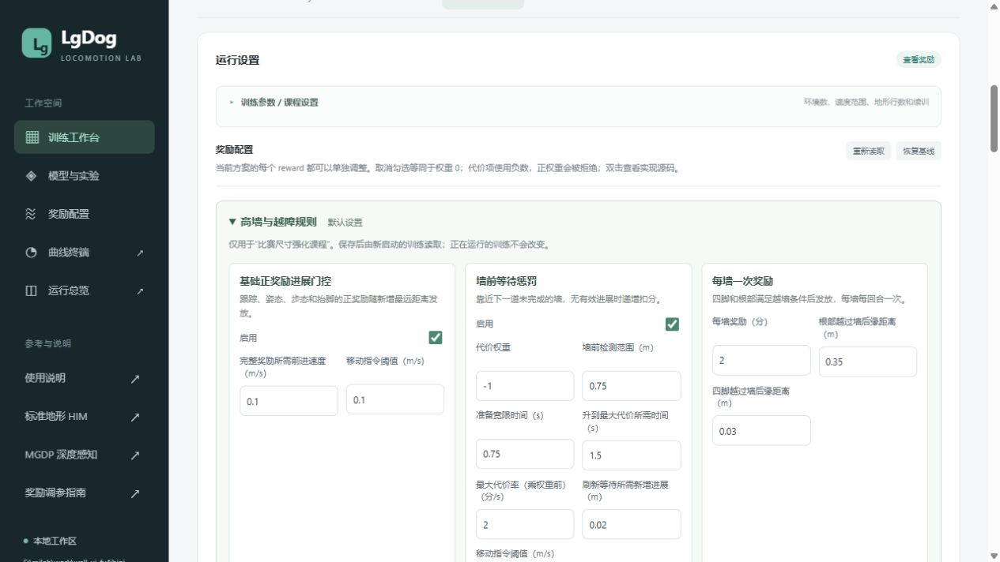

# 高墙规则工作台（2026-11-15）

工作台选择 **MGDP · 比赛尺寸强化课程 → 查看奖励 → 高墙与越障规则**。左侧“奖励配置”也进入同一编辑页。其他任务不显示该面板。

| 设置 | 默认值 | 生效范围 |
|---|---|---|
| 基础正奖励进展门控 | 启用；完整奖励参考速度0.1 m/s；移动指令阈值0.1 m/s | 仅高墙列的跟踪、姿态、步态和抬脚正奖励 |
| 墙前等待惩罚 | 权重−1；检测范围0.75 m；宽限0.75 s；递增1.5 s；最大2分/s；新增2 cm刷新 | 下一道尚未完成的墙 |
| 每墙一次奖励 | +2；根部越后缘35 cm、四脚越后缘3 cm | 每墙每回合一次 |
| 新增路线距离奖励 | 权重1 | 强化课程所有地形 |
| 出口成功奖励 | +5 | 强化课程所有地形 |
| 无进展终止 | 启用；4 s；新增5 cm刷新；移动指令阈值0.1 m/s | 强化课程所有地形的训练，回放不启用 |

点击“保存高墙规则”写入 `src/wall_reward_settings.py` 的 `WALL_REWARD_OVERRIDES`，先生成同目录 `.py.bak` 备份；编辑记录追加到 `logs/dashboard/history/`。不需要修改 Python 代码，也不需要重启工作台。

**只有新启动的训练进程读取保存值，已运行的训练不会改变。** “恢复默认”先恢复表单显示，再点击保存才写入文件。“重新读取”丢弃表单中未保存的修改。等待惩罚权重只能为0或负数；空值、非有限数字、超范围、未知参数均拒绝写入。

面板下方是 MGDP 共享基础权重；修改它们会影响使用该 profile 的其他 MGDP 任务。距离和出口奖励已从下方通用列表移除，避免两个编辑入口显示不同值；这两项以高墙面板为准。

完整续训要求奖励目标一致。未改动的默认规则保持原 V5 契约；保存非默认值后，契约随设置变化。使用旧设置训练的检查点需通过 `--warm-start-checkpoint` 迁移策略；用新设置生成的检查点，在设置一致时可完整续训。恢复默认不会自动让非默认设置的检查点变成兼容。

工程实现：

- `src/wall_reward_settings.py`：字段、范围、读取、保存和契约。
- `src/dashboard/routes.py`：`GET /api/wall-rewards`、`POST /api/wall-rewards/save`，沿用工作台令牌与来源校验。
- `src/tasks/velocity/config/lgdog1/mgdp_env_cfg.py`：注册新训练任务时加载设置，生成实际 reward / termination 参数。
- `src/tasks/velocity/mdp/wall_training.py`：物理进展门控、等待惩罚、越墙与停滞逻辑。



截图来自临时测试工程；默认值已恢复，未更改正式工程配置，也未从测试页面启动训练。截图中缺少感知文件的提示属于测试工程。

## 部署

增量补丁 `E:/算力自由/mgdp_wall_workbench_20261115.zip` 包含此前统一八档课程和高墙防刷分依赖。上传 zip 和同名 `.sha256` 后：

```bash
cd /root
sha256sum -c mgdp_wall_workbench_20261115.zip.sha256 && unzip -o mgdp_wall_workbench_20261115.zip -d /root
cd /root/unitree_rl_mjlab_lgdog
conda activate /root/lgdog
source server_env.sh
lgdog_server_env "$PWD"
```

重启原工作台服务并刷新页面，再按以上入口编辑。先结束旧工作台进程再使用原启动命令启动，避免旧进程保留旧 API。新训练沿用项目原启动流程。

验证结果见 [MGDP_WALL_WORKBENCH_VALIDATION.json](MGDP_WALL_WORKBENCH_VALIDATION.json)。CPU 工程检查不代表 GPU 吞吐、策略收敛或越墙成功。
