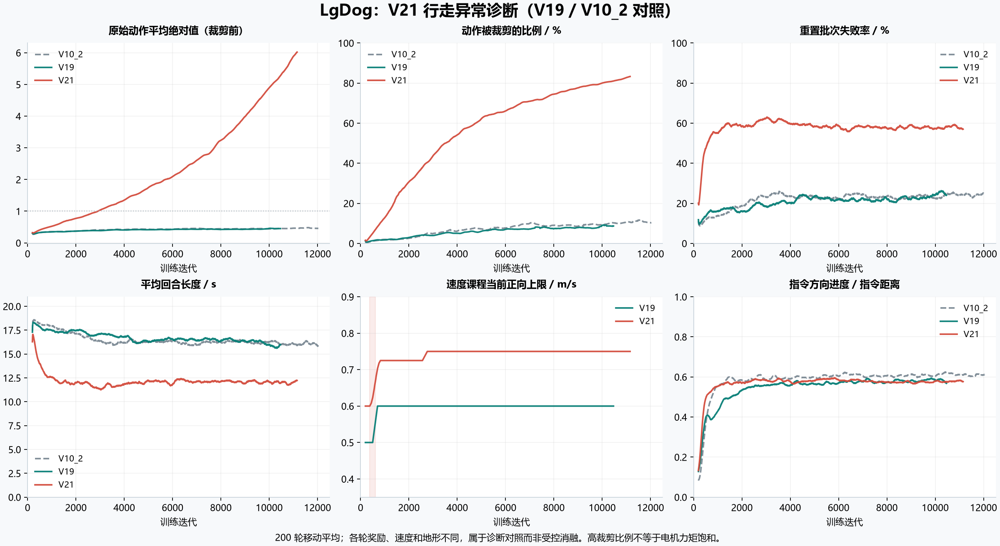

# V21 行走异常诊断：奖励方向、动作裁剪与速度课程

分析日期：2026-10-27（Asia/Shanghai）。分析阶段只读取训练归档，没有启动训练；随后按用户授权落实的代码修复见第 10 节。下列统计均来自修复前的 V19/V21。

## 结论与证据边界

V21 确实发生了策略退化，不能用“还要再训练久一点”解释。第一项必须修复的错误是 **`foot_clearance=+1.0` 把非负的抬脚误差代价变成了正奖励**。另外，速度课程的直接分数丢失了提前失败的约束，在大量回合失败时仍扩大指令范围；新地形又抬高了起始台阶高度。后期策略原始输出持续膨胀，81.9% 的动作分量被裁剪，符合行走缺乏细腻控制、摆腿生硬的表现。

这不是单变量实验：不能从这些日志精确分配每项改动的因果贡献，也不能在没有视频/关节轨迹时断言某一条腿的具体异常。但奖励方向错误、课程判据缺口和动作输出退化分别有代码、配置和曲线证据。

上次把 V19 的 `tracking_ratio≈0.55` 直接当成“稳态欠速”的证据不充分。该值还受换指令、侧向偏差、转向以及失败回合影响；不能据此同时重做速度奖励和课程，然后假定会改善。上一版同时引入相对误差、降低姿态约束并改课程，缺少固定地形/指令条件下的消融验证，应作为待回退对照的实验改动。

## 1. 本轮身份及读取范围

| 项 | V19 | V21 |
|---|---|---|
| 目录 | `E:\mjlab\数据\V19` | `E:\mjlab\数据\V21` |
| 启动时 Git 提交 | `1c0265a` + 奖励覆盖 | `0a35707` + 奖励/地形覆盖 |
| 任务 | `LgDog1-Rough-Blind-HIM-Standard` | 同左 |
| 并行环境数（实际 env.yaml） | 2048 | 2048 |
| 随机种子 | 42 | 42 |
| rollout | 48 | 50 |
| history / action clip | 6×47 / ±1 | 同左 |
| 地形网格 | 8×20 | 8×15 |
| 曲线末迭代 | 10466 | 11153 |
| 保存模型 | `model_10400.pt` | `model_11100.pt` |

V21 实际启动命令是 `--env.scene.num-envs=2048 --terrain-num-rows=8 --velocity-min-abs=0.8 --velocity-max-abs=1.2 --agent.run-name=V21_seed42`，`resume: false`。V21 的曲线比最后保存模型多 53 轮；以下统计以完整 event 文件为准。

读取了两轮 `params/env.yaml`、`params/agent.yaml`、`git/*.diff`，V10_2 的对应文件，以及 `数据/日志/reward_edits.jsonl`、`train_runs.jsonl` 和 `面板任务日志.tar.gz` 内的训练/Play 输出。没有反序列化不安全的 YAML Python 对象，没有加载 checkpoint 执行推理。

## 2. 最近 1000 个迭代记录的均值

各轮各取自己的末尾 1000 轮。它们的指令、地形和部分奖励不同，所以表格用于诊断变化，不能当作受控性能排名。

| 指标 | V19 | V21 | V10_2（辅助对照） |
|---|---:|---:|---:|
| 重置批次失败率 | 24.37% | **57.85%** | 24.30% |
| 平均回合长度 / 控制步 | 798.67 | **602.12** | 802.71 |
| 平均回合长度 / s | 15.97 | **12.04** | 16.05 |
| 原始动作平均绝对值 | 0.447 | **5.590** | 0.467 |
| 动作分量裁剪比例 | 8.43% | **81.93%** | 10.85% |
| 每步原始动作最大值的迭代均值 | 2.789 | **36.788** | 3.424 |
| 策略标准差 | 0.109 | **1.930** | 0.104 |
| `tracking_ratio` | 0.584 | **0.577** | 0.610 |
| 地形课程的 XY 速度误差 / m/s | 0.125 | **0.197** | 0.148 |
| Episode_Metrics 的 XY 速度误差 / m/s | 0.223 | 0.234 | 0.253 |
| 足端滑移速度 / m/s | 0.0386 | **0.1033** | 0.0392 |
| 落足接触力指标 / N | 46.22 | **56.24** | 44.51 |
| 地形升级比例 | 6.89% | 5.10% | 9.73% |
| 地形降级比例 | 15.13% | **51.53%** | 17.31% |
| 平均 episode reward | 67.72 | 32.69 | 66.68 |

失败率来自 `Curriculum/terrain_levels/reset_batch_failure_fraction` 的每轮记录均值。`Episode_Termination/*` 是重置批次的事件计数，可能大于 1，不能直接当作百分比。两个 XY 速度误差指标的回合选择/汇总口径不同，不能混着比较。总 reward 还受到权重和存活时间变化的影响，不能单凭它判定速度追踪好坏。



## 3. 已确定的奖励方向错误

### 3.1 实际跑的值与提交里的默认值不同

V21 启动前的审计记录：

- 2026-10-26 19:06:05：`feet_air_time: 0 → 1`。
- 19:06:26：**`foot_clearance: 0 → +1`**，`target_height` 仍是 0.10 m。
- 19:06:31：`feet_stumble: -0.5 → 0`。
- 19:06:56：`track_linear_velocity: 3 → 2.5`，保留 `relative_weight=0.35`。
- 19:07:32：启动 V21。

`V21/params/env.yaml` 确认这些值实际生效。`数据/索引.md` 把 V21 的线速度权重概括成 3.0 不准确，本轮实际是 **2.5**；不能只看 Git 中的 profile 默认值。面板覆盖优先级更高。

### 3.2 `foot_clearance` 是代价函数，不是越大越好的高度奖励

本轮绑定的是 `blind_mdp.feet_clearance_terrain` → `clearance_cost`。函数只对有有效射线、未接触且有运动指令的摆动足计算：

```text
cost = sum_i(abs(foot_clearance_i - 0.10) * foot_horizontal_speed_i)
step_contribution = cost * weight * 0.02
```

`cost ≥ 0`。负权重会惩罚离目标高度更远的动作；0 关闭；正权重会奖励误差更大、摆脚更快的动作。它不会自动把 `+1` 理解成“多抬脚”。脚过低和过高都能增大绝对误差，因此可能学成低扫、甩腿或过度抬脚，具体形式需要视频/轨迹判断。

V21 末 1000 轮的 `Episode_Reward/foot_clearance` 是 **+0.0611**，而 V19 为 0，确认这项误差代价在给策略加分。这项数值不是总奖励最大的项，不能单凭占比宣称它独自造成全部退化；但其优化方向确定错误，应最先修正。

## 4. 动作控制已发生明显退化

V21 的动作裁剪比例不是偶发峰值，而是随训练持续增大：

| 迭代范围 | 原始动作平均绝对值 | 裁剪比例 | 策略 std | 失败率 |
|---|---:|---:|---:|---:|
| 0–499 | 0.362 | 3.17% | 0.267 | 34.85% |
| 500–1999 | 0.618 | 19.65% | 0.311 | 57.37% |
| 2000–4999 | 1.240 | 49.30% | 0.564 | 60.17% |
| 5000–7999 | 2.431 | 69.00% | 0.968 | 57.86% |
| 8000–11153 | 4.613 | 79.22% | 1.636 | 57.80% |

V21 第 3359 轮首次记录到裁剪比例超过 50%。到末尾一条记录，比例为 83.59%，raw mean 为 6.104，std 为 2.088。V19 的末 1000 轮 raw mean 约 0.447、std 约 0.109。

执行链是原始动作 → 裁剪到 ±1 → 乘动作缩放 0.25 → 加默认关节位置。大量原始输出落在执行范围外，许多不同输出会变成同一个边界目标，减少有效控制分辨率；这是摆腿生硬、切换突兀的机制之一。

这里统计的是训练时的策略采样动作，不等于电机力矩饱和，也不等于已经测得 Play 的确定性策略裁剪率。不能把 V19 的 8% 和 V21 的 82% 都简单归为同一种“观察项”。原始输出惩罚系数仍是 `1e-4`，V21 末段记录的每步惩罚约 `8.58e-5`；现有约束没有阻止这次输出膨胀。

## 5. 上次速度课程改动存在判据缺口

旧课程使用跟踪奖励之和除以“最大回合时长 × 回合数”。短回合的累计奖励较少，因此分数隐含了存活时间的影响。

新增的直接分数改成：

```text
active_tracking_score_sum / active_command_step_count
```

这能排除站立样本，但也把短回合没有活到的时间从分母里移除了。当前升级判断只检查该分数的 EMA 和连续次数，没有检查提前失败率、回合完成度或实际指令进度。新相对误差奖励也没有进入这个绝对误差分数。

V21 实测：

- 约第 380–620 轮，正向上限连续从 **0.60 扩到 0.725 m/s**；对应的失败率约 **45%–52%**，进度门通过率只有约 **1%–3%**。
- 第 2560 轮扩到 **0.75 m/s**；此前 31 轮的平均失败率约 **60.9%**，但课程分数约 **0.7835**，仍满足升级条件。
- 后期分数约 **0.757**，位于升级 0.78 / 回退 0.62 的稳定带，故长期保持 0.75 m/s，没有因为约 58% 的失败率而回退。

所以“阈值调高、连续 3 次达标”本身没有解决课程稳定性问题。必须把存活/失败信息纳入升级和回退，且与实际追踪质量一起判断。上一版这部分应修正或先回退，不能继续只调一个分数阈值。

## 6. 其他同时发生的分布变化

| 项目 | V19 实际值 | V21 实际值 | 含义 |
|---|---|---|---|
| `foot_clearance` | 0 | **+1** | 首要奖励方向错误 |
| 线速度权重 | 2.0 | 2.5 | 本轮不是提交默认的 3.0 |
| 相对误差混合 | 0 | 35% | 低速误差更敏感，未做单变量验证 |
| `pose` | 1.5 | 1.0 | 姿态奖励减少 |
| `action_rate_l2` | **-0.1** | **-0.1** | 两轮相同，不能说它本轮又被降低 |
| `feet_air_time` | **1.0** | **1.0** | 两轮相同，不能认定“新开 airtime”是主因 |
| `soft_landing` | -0.002 | -0.001 | 落足冲击约束减弱 |
| `feet_stumble` | -0.5 | 0 | 撞台阶立面的约束关闭 |
| 站立指令比例 | 25% | 10% | 训练更少覆盖站住，更多覆盖移动 |
| 初始 vx 范围 | (-0.3, 0.5) | (-0.4, 0.6) | 从训练开始就提高速度要求 |
| 最终 vx 上限配置 | (-0.6, 1.0) | (-0.8, 1.2) | 最终包络提高，实际未升到终值 |
| yaw 包络 | ±0.75 rad/s | ±0.90 rad/s | 所有非站立环境仍以 heading 模式生成 yaw |
| 台阶高度范围 | 0–10 cm | **5–15 cm** | 初始课程台阶也被抬高 |
| 坡度梯度范围 | 0–1.0 | 0–0.4 | 坡面反而降低，不能统称所有地形都更难 |

8 行课程中 `difficulty=(row+U[0,1))/8`，台阶高度为 `h_min+difficulty*(h_max-h_min)`。因此：

| 台阶行 | V19 | V21 |
|---|---|---|
| row 0 | 0–1.25 cm | **5–6.25 cm** |
| row 1 | 1.25–2.50 cm | **6.25–7.50 cm** |

两轮初始均只在 row 0–1 训练，但实际台阶任务已不同；同样的 `level_mean≈1.7` 不能当作相同越障能力。不是把最大高度改到 15 cm 后，低等级仍保持原来的 0–2 cm。

本项目 `feet_air_time` 还与原版 HIMLoco 的落脚时累计 airtime 函数不同：它在恰好两脚接触时，奖励接触/腾空模式持续时间接近 0.4 s。周期 0.6 s、支撑占比 0.56 的 `foot_gait` 对应摆动约 0.264 s。两者可能有目标张力，但 V19 也同时启用，因此不能拿它解释本轮新出现的全部退化。

## 7. 日志另有 heightfield 碰撞溢出

训练日志 `jobs/a7995aa83fdb.log` 中检出 **24081 条**：

```text
height field collision overflow, number of collisions >= 50
decrease the number of hfield rows/cols or modify size of colliding geom
```

V21 Play 日志也有 6 条。V19 训练日志同样有 10931 条，因此它是已有的物理接触风险，不能当作 V21 唯一新增原因，也不能由打印次数直接换算失败回合占比。

上游 [MuJoCo Warp 的 heightfield 碰撞实现](https://github.com/google-deepmind/mujoco_warp/blob/main/mujoco_warp/_src/collision_convex.py) 在单个碰撞对收集接触候选时触及 `MJ_MAXCONPAIR` 后停止继续收集并打印这类警告。当前上游源码用于解释警告机制；部署机确切安装版本仍应在机器上核验。这个上限与场景 `nconmax` 不是同一个容量，单纯增加 `nconmax` 不是针对性修复。应核对高度场采样密度、碰撞 geom 尺寸和候选生成，单独做仿真回归。

原始 stderr 没有提供导致关节异常的完整逐步轨迹，因此目前不能量化它对步态的贡献。

## 8. 最小修复与消融顺序

当前本地 Git 默认 `foot_clearance` 仍是 0；有问题的 +1 来自训练机的面板覆盖。只改 profile 或重新 pull，不保证消除覆盖。下一次应先检查实际导出的 `env.yaml`。

1. **先修正方向**：在训练机把 `foot_clearance` 覆盖从 +1 改回 **0**，恢复 V19 已验证过的关闭状态；如果以后要测试高度代价，再单独试小负值。不要直接把“开启”当成 +1。
2. **先修正/回退速度课程**：恢复存活和失败约束，防止回合失败很多仍扩速；固定 V19 的初始/最终速度与 yaw 范围做对照。
3. **建立可比较基线**：恢复 V19 实际的 `pose=1.5`、`track_linear_velocity=2.0`、`relative_weight=0`、`soft_landing=-0.002`、`feet_stumble=-0.5`、站立比例 25%。保留 V19 已经使用的 `feet_air_time=1.0`、`action_rate_l2=-0.1`，避免把相同项也当新变量。
4. **固定地形后比较**：排查 reward 时先回到 V19 的台阶下限 0，或明确声明是在 5 cm 起步的新任务上评估。不要一边换奖励一边把起始台阶提高。
5. 修复配置不会改变已经训练好的 V21 权重。保留 V21 作为失败实验，另起编号从头做诊断短跑；不要把它继续跑长当成唯一解决方案，也不要删除旧证据。
6. 在相同地图、同一组固定速度和相同出生姿态下，记录确定性 Play/Sim2Sim 的速度误差、裁剪比例、摆动足高度、接触/滑移和失败率。先做约 1000–2000 轮的排错检查；这不是收敛承诺。没有出现原始输出持续膨胀和高失败率后，再继续训练和跨种子比较。

还应为工作台增加奖励语义提示：对抬脚误差、滑移、动作变化等非负代价，显示“负数惩罚，0 关闭”，正权重明显提示“方向反转”；保存时展示最终生效配置。分析时的界面没有充分区分代价与正奖励，是这次误配容易发生的原因之一。随后实现的校验与课程修复见第 10 节。

## 9. 复核材料

- 解析脚本：`E:\mjlab\work\analyze_v21_20261027.py`。
- 统计和抽取的标量序列：`E:\mjlab\work\v21_analysis_20261027.json`。
- 绘图脚本：`E:\mjlab\work\plot_v21_20261027.py`。
- 训练/Play 摘录：`E:\mjlab\work\v21_train_excerpt.txt`、`v21_play_excerpt.txt`。
- 图：`doc/images/V21_DIAGNOSTICS_2026-10-27.png`。

TensorBoard 和绘图库在本机 `E:\mjlab\.analysis_deps` 中使用；没有安装或修改训练机环境。源 events、模型、归档和面板审计记录均保持原样。


## 10. 分析后的代码修复（2026-10-27）

用户随后要求上传讨论的修改，本次将以下修复写入代码，未进行新 GPU 训练：

- `him_standard` 显式恢复 V19 奖励基线：clearance 0、stumble -0.5、airtime 1.0、线速度 2.0、pose 1.5、动作变化 -0.1、落地冲击 -0.002；相对误差混合设为 0。标准 HIM 训练站立比例恢复 25%。
- 速度课程继续使用移动样本的跟踪分数 EMA，但扩速要求已完成回合平均存活 ≥80%、非超时失败率 ≤25% 且有移动样本。分数 ≥0.78 并连续三次通过后扩大 0.025；连续两次分数 <0.62、存活 <65% 或失败率 >35% 时回退 0.025，最低退回初始范围。门限为待训练验证的修复配置，不是论文已证明的最优值。
- 检查窗口保存新增计数。旧版课程 checkpoint 恢复范围后清空不完整窗口和连续次数，避免缺少失败统计却直接扩速。
- 工作台显示存活比例、失败率和扩速安全门；奖励区显示正负方向。面板保存、配置工厂拒绝给非负代价配置正权重，旧覆盖仍可读取并纠正。
- 地形保留用户当前指定的 5–15 cm 台阶等配置，未回退为 V19 的地形；HIM 网络、PPO 优化器、动作映射和部署接口未改。

训练机更新后，须在奖励区点击“恢复基线”并保存，清除旧覆盖，再核对新 run 的 `env.yaml`。这次不是完整复现 V19：地形、课程规则及 rollout 仍与其不同。应另开编号，在同条件评估和训练中确认是否改善，不能把 CPU 回归通过当作步态通过。
