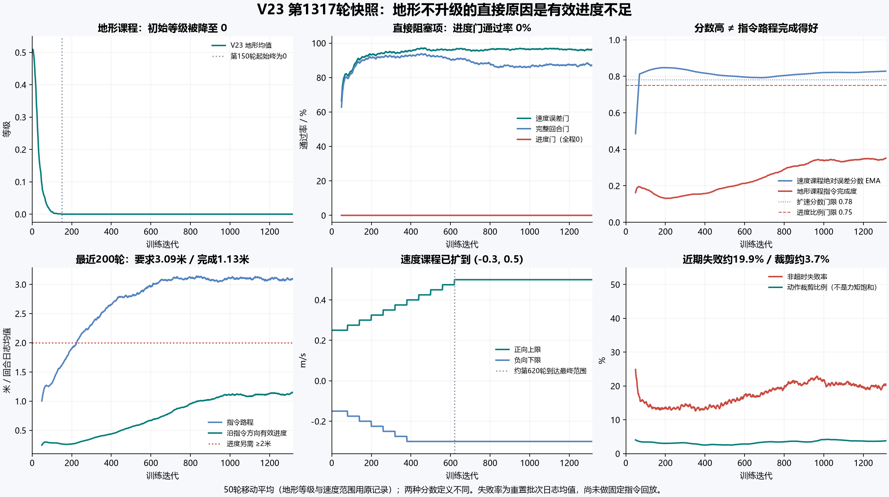

# V23：地形全程不升级的诊断

分析日期：2026-10-27，Asia/Shanghai。分析阶段只读取本机同步快照，没有停止训练或加载执行 checkpoint；随后按用户要求实现的课程修复见第8节。

## 结论

地形等级为 0 的直接原因已经确认：**进度门 `progress_gate_pass_fraction` 全程为 0，导致升级比例也全程为 0**。这是日志实际的零值，不是显示取整。初始等级均值约 0.509，第 150 轮起始终为 0。

速度误差门、完整回合门并未全部阻塞；新增的速度课程存活/失败率门也没有锁住速度范围。相反，速度课程约第 620 轮就已扩到本轮设定的最终范围 `vx=(-0.3, 0.5)`。不能把本轮解释成“存活门拦住扩速，所以地形不升级”，也不能仅凭轮数把全程无升级称为正常。

最近 200 轮，平均指令路程约 3.09 m，有效进度只有 1.13 m，记录的指令完成度约 34.7%。速度课程绝对误差分数 EMA 却约 0.825，超过其扩速门限 0.78。**两种判据没有对齐：较好的绝对误差分数不保证较高的指令完成度。**

## 1. 实验身份与数据边界

| 项目 | 实际值 |
|---|---|
| 数据目录 | `E:\mjlab\数据\V23` |
| 原运行名称 | `2026-10-27_11-13-03_V23_seed42`，名称来自归档索引 |
| Git | `51fd9cf429e13af27f83e85178280ea2c3ae1ed9`，另有未提交的奖励与地形覆盖 |
| 任务/seed | 标准 Rough HIM-PPO / 42 |
| 环境数 / rollout | 2048 / 每环境 50 控制步 |
| 训练方式 | `resume: false`，计划 16000 轮 |
| 快照最后迭代 | **1317**，最后 checkpoint 为 `model_1300.pt` |
| 最后一条 event 时间 | **2026-10-27 12:56:14.756 +08:00** |
| 地形 | 8 行 × 15 列；台阶 5–15 cm，初始等级 0–1 |
| 初始指令范围 | vx `(-0.15, 0.25)`、vy `±0.09375`、yaw `±0.375` |
| 最终平面范围 | vx `(-0.3, 0.5)`、vy `±0.1875`；yaw 全程保持其配置范围 |

归档索引写到 1315 轮，实际 event 多两轮；本报告以 event 为准。这是正在训练时的静态同步快照，不代表训练已经停止，也不能用它判断 1317 轮之后的状态。未从配置中的 2048 环境数直接推断显存占用或 OOM。

## 2. 最近 200 轮（1118–1317）

下表为每条迭代日志的均值。课程通过率/失败率来自重置批次汇总，不是重新按所有回合数加权的统计。

| 指标 | 均值 | 含义 |
|---|---:|---|
| 地形等级均值 | **0.000** | 第150轮以后一直为0 |
| 地形升级比例 | **0.00%** | 全部1318条记录都为0 |
| 进度门通过率 | **0.00%** | 全部1318条记录都为0，直接阻塞 |
| 速度误差门通过率 | 96.19% | 0.8 m/s 门限基本通过 |
| 完整回合门通过率 | 87.27% | ≥18秒的门并未全部阻塞 |
| 地形课程 XY 平均误差 | 0.1458 m/s | 已按控制步数计算，不是旧版单位放大错误 |
| 指令路程 | **3.090 m** | 累计移动指令要求的距离 |
| 沿指令方向有效进度 | **1.127 m** | 逆向/横向漂移不加分，超速不额外加分 |
| 指令完成度 `tracking_ratio` | **0.3467** | 低于升级要求0.75，接近降级边界0.35 |
| 非超时失败率 | 19.86% | 仍需改善，但不是本轮唯一阻塞项 |
| 速度课程分数 EMA | **0.8249** | 高于扩速门限0.78 |
| 速度课程存活比例 | 86.77% | 通过80%门限 |
| 速度课程失败率 | 20.04% | 通过25%门限；统计窗口与地形批次不同 |
| 速度课程扩速安全门 | 100% | 最近200轮均允许累计扩速连续次数 |
| 训练回合长度 | 866.4步，约17.33秒 | 来自 `Train/mean_episode_length`，与课程窗口口径不同 |
| 原始动作平均绝对值 | 0.3885 | 裁剪前策略输出 |
| 动作裁剪比例 | **3.72%** | 不是电机力矩饱和率 |
| 策略标准差 | **0.1899** | 截至快照没有V21后期那种持续膨胀证据 |



## 3. 地形升级到底被哪里挡住

当前 `blind_mdp.py::terrain_decisions` 要求同一个回合同时满足：

```text
指令路程 >= 1.0 m
没有非超时失败
存活 >= 90% × 20 s = 18 s
XY平均速度误差 <= 0.8 m/s
有效进度 / 指令路程 >= 0.75
有效进度 >= 2.0 m
离开出生中心1.75 m以外，累计 >= 1.0 s
```

其中日志中的“进度门”合并了 **完成度≥0.75 和进度≥2 m**，没有分别记录两项通过率。因此可以确认这一组合门全程不通过；不能仅凭现有汇总声称每个回合都只被完成度、或只被2米要求拦住。低平均进度和低完成度表明两项都值得优先排查。

进度是逐步投影并限幅后的累计量，不是最终坐标位移，也不等于稳态速度比。低进度可能来自持续欠速、指令切换响应慢、侧向漂移或方向不一致；需要固定指令回放才能进一步区分。不能把0.347直接说成每个时刻都只跑到目标速度的34.7%。

另一个可能的额外限制是出生平台：最近200轮 `Episode_Metrics/outside_spawn_platform` 均值为0.00027568。按该项返回“是否在平台外 × 0.02 s”、MetricsManager再除控制步数的实现，相当于平均约 **1.38%的回合控制步**处于平台外。它不能直接换算为“平台门通过的回合比例”，但说明平台外暴露很少。由于进度门已经全零，平台门不是解释当前零升级所必需的原因；仍需补充独立通过率才能判断它会不会成为后续瓶颈。

地形等级0仍有地形。8行配置下，最低一行台阶高度约5–6.25 cm，不等于纯平地训练。

## 4. 为什么速度分数很高，进度仍然低

本轮速度课程使用 `ops.linear_velocity_tracking` 的绝对误差核：

```text
score = exp(-(||command_xy - velocity_xy||² + 2*velocity_z²) / 0.5²)
```

在纯前进、竖直速度为0的简例中：

| 指令 vx | 实际 vx | 速度分数 | 逐步进度完成比例 |
|---:|---:|---:|---:|
| 0.2 m/s | 0 | **0.8521** | 0% |
| 0.2 m/s | 0.05 m/s | **0.9139** | 25% |

两者都超过扩速门限0.78。排除“站立指令”只排除了命令接近0的样本，没有排除“给了移动指令但机器人基本站着”的样本。新增的存活/失败约束也不会阻止一个站得住、却走不快的策略得高分。

这个例子说明判据存在可放过欠速的空间，并不证明V23全程原地不动：实际进度在增加，0.2 m/s也不是全部指令。V23约第80轮开始扩速，第380轮负向下限到-0.3，第620轮正向上限到0.5；当时地形进度完成度仅约0.233。当前速度扩张仍缺少明确的指令进度条件。

## 5. 这轮不是未经覆盖的V19恢复基线

`git/unitree_rl_mjlab_lgdog.diff` 明确记录了训练机的面板覆盖，`params/env.yaml`确认已实际生效：

| 权重 | 仓库恢复基线 | V23实际 |
|---|---:|---:|
| `track_linear_velocity` | 2.0 | **1.5** |
| `action_rate_l2` | -0.1 | **-0.02** |
| `body_orientation_l2` | -1.0 | **-0.5** |
| `pose` | 1.5 | 1.5 |
| `foot_clearance` | 0 | 0 |
| `feet_stumble` | -0.5 | -0.5 |
| `feet_air_time` | 1.0 | 1.0 |
| `soft_landing` | -0.002 | -0.002 |

抬脚代价正号错误已经消除，stumble也确实启用。线速度奖励权重比恢复基线低25%，姿态奖励没有同步降低，这可能减弱继续移动的收益；但单轮观察不能证明这一个权重就是全部原因。动作平滑惩罚减弱也不能自动证明是此次零升级的原因，当前裁剪和标准差没有出现V21后期那种异常。

最近200轮姿态奖励均值约1.238、线速度奖励约1.141。两者的贡献大小可用于检查奖励平衡，但不等于策略梯度大小，也不能单凭reward排名确定因果。

本轮非超时终止计数主要来自 `sustained_leg_contact`，其次才是机身接触/翻倒。各 `Episode_Termination` 项是计数日志，不能直接当作百分比或默认彼此互斥。地形上的腿部接触仍需观察，不应为了升级而直接关闭该终止。

## 6. 后续处理优先级

1. **先让扩速判据与有效移动一致。** 保留已加入的存活/失败约束，再增加移动指令进度条件，而不是继续只提高绝对误差分数门限。最好聚合窗口内的实际指令路程与有效进度，独立显示通过情况。门限需用对照训练确定。
2. **补齐地形诊断。** 分开记录完成度门、2米进度门、平台暴露门和无失败门，按地形类型观察。当前无法从一个组合进度门区分所有阻塞原因。
3. **固定奖励配置做对照。** 用明确的一组权重验证；如果要恢复仓库基线，先清掉这三项面板覆盖并另开实验。不要同时重改多项奖励、改地形、改速度上限，再把结果归因于某一项。
4. **核对低速任务与固定空间门限。** 当整回合只要求较短距离时，固定2米要求可能无法达到；频繁换向时也可能无法走出1.75米平台。应单独设计可编辑、与当前任务匹配的条件，保留真实地形暴露检查，避免只在平台上移动就升级。不要只把0.75降到0.3来让曲线好看。
5. **先做固定命令回放。** 同一模型/出生点下，分别测试前进0.2、0.4和后退-0.2 m/s，记录实际速度、有效进度、失败及接触，再区分稳态欠速与换指令响应问题。0.4和-0.2位于本轮已扩张的最终训练范围内，但高于初始范围。

截至1317轮，有效进度从第200–599轮均值约0.478 m提升到最近200轮1.127 m，说明还在学习移动；最近200轮进度约1.1 m，暂未接近升级所需水平。可以保留此轮作为诊断基线，不必因等级0立即删除；也不应承诺再等固定轮数就一定升级。快照不足以判断最终收敛或真实越障表现。

原归档 `索引.md` 将“速度课程的存活门”解释成“地形升级受阻”的段落与实际日志不符；本报告按两条课程的真实指标区分。HIM网络和PPO训练循环没有因本次分析而改变。

## 7. 复核材料

- 原始：`E:\mjlab\数据\V23\events.out.tfevents.1793070790.heartpain-R9000P.30348.0`。
- 实际参数：该run的 `params/env.yaml`、`params/agent.yaml`；工作区覆盖证据：`git/unitree_rl_mjlab_lgdog.diff`。
- 只读解析：`E:\mjlab\work\analyze_v23_20261027.py`。
- 汇总与绘图数据：`E:\mjlab\work\v23_analysis_20261027.json`。
- 绘图：`E:\mjlab\work\plot_v23_20261027.py`。
- 图：`doc/images/V23_CURRICULUM_DIAGNOSIS_2026-10-27.png`。

YAML使用BaseLoader仅提取数据，未执行Python标签；未加载模型权重、运行GPU训练或修改原始训练归档。分析阶段只新增文档和图；后续课程修复单独记录于第8节。


## 8. 后续实现：速度课程增加实际进度门

用户随后要求落实修改，本地实现了：

- 标准Rough-HIM与Flat-HIM扩速增加窗口进度≥60%的条件，连续三次与原分数/存活/失败门共同达标才扩速；进度连续两次<40%时回退。两值为初始修复配置，需要新训练验证。
- 分子/分母直接累计已完成回合的进度米数/指令米数，避免短回合比例抬高窗口分数。指令总路程不足1米的窗口不扩速，也不单凭进度回退。
- 旧v1/v2课程状态保留已有速度范围，清掉缺少进度统计的窗口及连续次数；新v3保存所需计数。旧模型续训不会立即回到半速，可能按新判据逐步回退。
- 工作台增加扩速分数门与进度门显示；地形75%完成度、2米距离、平台外1秒条件分别记录通过率。地形升级判据本身没有调整。
- 相对奖励参数与各项reward权重未改；HIM网络、PPO更新和部署接口未改。课程门只阻止提前扩速，不直接增加行走奖励。

验证：CPU unittest共133项，132项通过、1项跳过。工作台新增字段、新旧日志兼容和无数据状态的渲染逻辑检查通过。没有启动新GPU训练、停止现有训练或推送GitHub。使用与迁移说明见 [VELOCITY_CURRICULUM.md](VELOCITY_CURRICULUM.md)。
