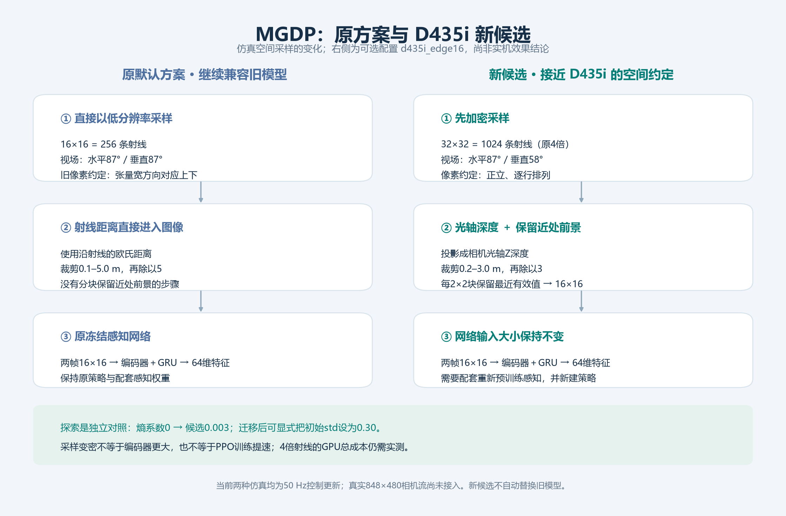
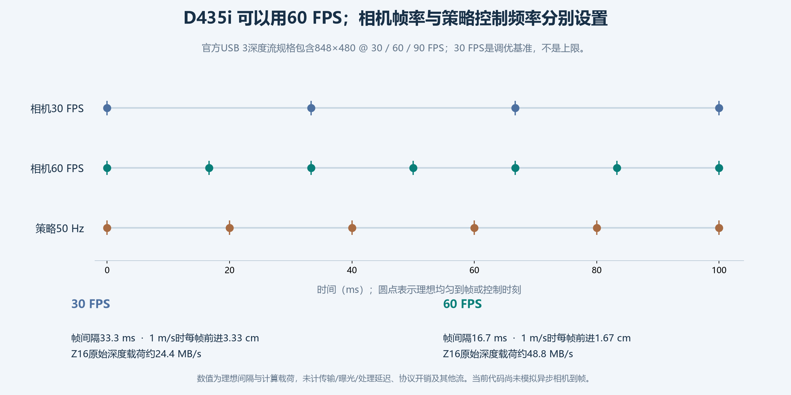

# MGDP新旧方案与D435i 30/60 FPS图文说明

**D435i可以用848×480、60 FPS深度流。30 FPS是官方调优文档的基准，不是相机能力上限。** 2026年3月数据手册表4-2（PDF第74页）列出USB 3模式下848×480支持6/15/30/60/90 FPS。表4-8的USB 2模式不同，848×480仅6/10 FPS，必须确认实际协商为USB 3。

原方案指当前保留给旧模型的仿真；新方案指可选d435i_edge16。两者都不是已经接通的D435i实机流。旧仿真没有先采集848×480再缩小的过程，而是直接发出256条射线。新仿真发出1024条射线，再按每个2×2区域的最近有效Z深度压回16×16，两帧编码为64维特征。因此编码器图像尺寸没有扩大，但射线成本会上升；新视觉约定需重新预训练感知并新训策略。

最近有效值示例：一块2×2区域为[[1.2,2.9],[0,2.8]]米，零为无效值，结果保留1.2米。它有利于保留小前景，也会保留孤立的近处噪声；不是无条件更准确。

| 对比项 | 30 FPS | 60 FPS |
|---|---:|---:|
| 理想帧间隔 | 33.33 ms | 16.67 ms |
| 0.35 m/s时两帧间前进距离 | 1.17 cm | 0.58 cm |
| 1.00 m/s时两帧间前进距离 | 3.33 cm | 1.67 cm |
| 848×480、Z16原始载荷 | 24.42 MB/s | 48.84 MB/s |

这些是直接计算值，不是测得的端到端延迟。原始载荷按848×480×2字节×FPS计算，不包括USB协议开销、RGB/红外/IMU流或主机处理。

60 FPS可提供更密集的运动观测，但并不自动增加每帧的空间采样。当前新旧仿真都是0.005秒物理步长×4子步=0.02秒控制步，即50 Hz；没有30/60 FPS异步帧、排队延迟、曝光或运动模糊模型。实机可让相机60 FPS、策略保持50 Hz，每次使用最新可用帧；不必把物理控制和PPO频率都改成60。该策略应以时间戳检查帧龄与丢帧，不能只看配置里的FPS数。

60 FPS需要曝光与16.7 ms帧周期相适配。更高帧率本身不保证运动模糊更小；曝光、光照、纹理、投射器和增益共同影响深度有效率。原本依赖较长曝光的暗环境可能需要更短曝光或更高增益，进而改变噪声和填充率；在充足光照、相同短曝光下，不能预设60 FPS一定比30 FPS更差。官方高速成像文档也指出高对比度、有纹理目标不一定需要很长曝光。

对本项目，我建议1 m/s目标的实机先测试848×480、60 FPS深度流，并保留30 FPS作对照。观察实际到帧率、帧间隔P95、深度有效率、墙面有效像素和曝光；稳定后再选择。60 FPS不会自动缩短GPU PPO训练的总时间。

## 官方来源

- [D400系列数据手册，2026年3月，表4-2和表4-8](https://www.realsenseai.com/wp-content/uploads/2026/03/RealSense-D400-Series-Datasheet-Mar-2026.pdf#page=74)
- [D400视觉预设：848×480、30 FPS、自动曝光基准](https://dev.realsenseai.com/docs/d400-series-visual-presets/)
- [D435高速成像：运动与曝光的关系](https://dev.realsenseai.com/docs/high-speed-capture-mode-of-intel-realsense-depth-camera-d435/)

空间参数核对：src/mgdp_depth.py、mgdp_env_cfg.py和MGPDPerceptionCfg；50 Hz依据CPU验证run保存的decimation=4、timestep=0.005。此说明不改变原训练配置、不修改已有补丁及校验文件。
