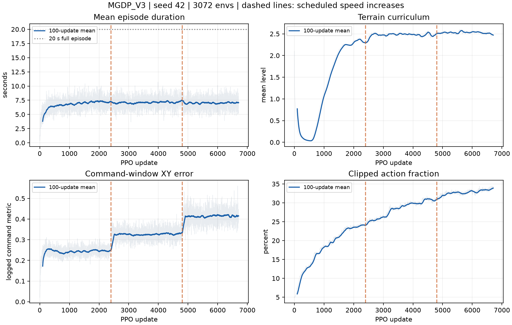

# MGDP_V3：看见障碍却难以通过的训练审查

日期：2026-11-04。只读原始归档；未启动新训练，未用当前感知模型替换旧模型回放。

## 数据来源

- `E:/mjlab/数据/MGDP_V3/`：TensorBoard 6707 个更新点（0–6706），model_0.pt 至 model_6700.pt 共 68 个训练检查点。
- 保存的 agent/env YAML：seed=42、3072 环境、每环境 50 控制步、20 秒回合、控制周期 0.02 秒；actor=4×47+64=252，critic=261。
- git 快照：`c1f59fae21187df5fdf2e0e80c80e35015a21f55`，另有 rough 奖励覆盖；不能用当前配置代替该轮配置。
- 配套感知权重未出现在该 run 归档。配置只保存了相对路径 `logs/mgdp/perception/mgdp_perception.pt`。

## 曲线事实

| 指标 | 更新 2000–2399 | 2400–2799 | 4800–5199 | 最后 500 次 |
|---|---:|---:|---:|---:|
| 平均回合时长 / s | 7.216 | 7.036 | 6.969 | 7.067 |
| 平均地形等级 | 2.335 | 2.454 | 2.524 | 2.506 |
| 命令窗口 XY 误差指标 | 0.247 | 0.324 | 0.412 | 0.415 |
| 动作分量裁剪比例 | 23.894 | 25.306 | 31.981 | 33.524 |
| 平均回报 | 34.128 | 30.995 | 28.800 | 29.491 |

图中两条竖线是固定扩速门槛：120000 / 50 = 2400 次更新、240000 / 50 = 4800 次更新。
保存配置把 vx 从 (-0.4,0.5) 扩至 (-0.6,0.75)，再到 (-0.8,1.0) m/s，同时改变 vy/yaw 范围；代码在步数超过门槛后应用，所以实际变化在门槛附近。
两次扩速与误差上跳同时发生，末段未恢复到原误差水平。这支持“扩速超出当时能力”的怀疑，但不是单独改变扩速规则后的因果对照。

平均回合约 7.07 秒，仅占完整 20 秒的 35.3%；这是平均时长比例，不是存活率或成功率。
动作裁剪比例约 33.5%，统计的是裁剪前动作分量，不代表同样比例的控制步或关节机械限位。

`Metrics/twist/error_vel_xy` 按每次命令窗口的最大步数归一化累加，并在重采样时重置，不能直接当作逐控制步平均 m/s 误差。
`Episode_Termination/illegal_contact` 等是每次 reset 的终止计数，TensorBoard 再按 rollout 聚合，数值 6.23 不能解释成 623% 失败率；终止项还可能重叠，本报告不将计数相加推算精确失败率。

## 与越障目标的具体错位

1. **扩速按时间，未按越障能力门控。** MGDP 使用 `commands_vel` 的固定阶段；这轮在平均回合仍明显不足时继续扩速。HIM 标准任务的跟踪/存活门控不能自动视为也用于 MGDP。
2. **任务只要求跟踪随机速度，没有逐障碍通过合同。** 每 3–5 秒重采样，含横移和转向；`terrain_levels_vel` 用累计路程 >4 m 升级。路程增长可能来自绕行或在地块中活动，不能证明穿过目标障碍。日志没有按障碍类型记录通过率、接近距离或碰撞位置。
3. **短暂非足接触立即终止。** 配置中 `nonfoot_ground_touch` 排除脚，阈值 10 N。腿和机身统一处理；对有沟壑、台阶和轮胎的任务，可能压缩学习有效跨越动作的机会。需要按机身/腿分别诊断，不能直接关闭机身碰撞终止。
4. **训练几何不是当前比赛版。** 保存的是两柱单横梁和单轮胎环；当前是两座限高笼和 2×4 轮胎阵。旧模型没有因此自动学到完整比赛布局。
5. **感知预训练存在历史缺陷，但该轮是否用了随机 GRU 尚不可确认。** 当时源码的损失不经过 GRU；若未从官方权重初始化，GRU 不会在默认预训练中学习。归档缺少原感知文件及初始化记录，不能断言这轮一定是随机 GRU，更不能将所有表现问题归因于它。

actor 第一层确认输入 252 维；最后 64 维观测归一化标准差约 0.067–0.212，说明训练时感知输入有变化。此结果不能证明策略学会利用障碍信息。

旧 policy.onnx 标记为 `lgdog_ppo_v1 / history_length=1`，model_6700.pt 也未包含感知模型。此前的部署修复支持通过 `--perception` 显式传入原文件，但不能从 actor 恢复丢失的编码器。

## 建议的下一轮顺序

1. 找回这轮原始感知检查点；在固定低速、固定初始姿态和相同障碍下比较前/中/末检查点，再进行真实深度与打乱深度对照，判断策略是否使用视觉。每类障碍单列成功率。
2. 为 MGDP 建独立越障任务：明确入口、出口和目标方向；让出生点在障碍前；加入通过判定及朝出口的进度记录，限制“绕着走也能升级”。保持随机速度训练作为独立对照。
3. 用固定低速和单类低难度障碍建立基线，再按成功率/存活/跟踪门控增加难度或速度，每次只增加一个因素。
4. 核对机身与腿触地的分别统计后，再决定是否使用腿部短时接触宽限；同时观察动作裁剪和落足，避免只增大奖励权重。
5. 重做带序列 GRU 损失的感知预训练，保存数据来源和配套感知文件后开始新策略训练。旧策略继续绑定原编码器。

这轮总更新量约 10.30 亿 env-control-step（6707×3072×50），但采样量不等于有效越障样本量。曲线在早期改善后长期平台，继续同配置加轮数缺少证据支持。

完整分段数值见 [metrics.json](metrics.json)。指标来自 TensorBoard 日志，不是本轮重新运行策略的结果。
