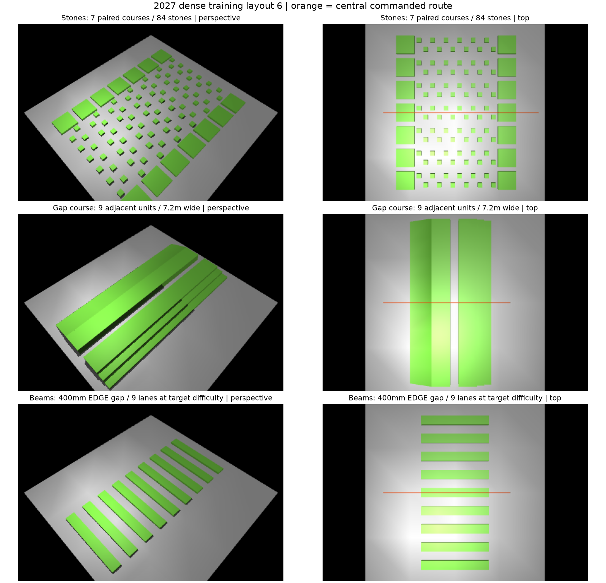
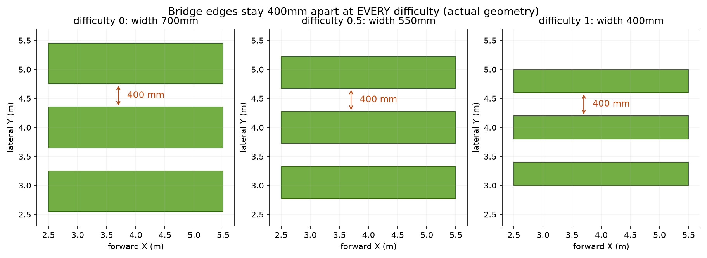

# 密集梅花桩、沟壑与400mm桥间净距

日期：2026-11-05。任务 `LgDog1-Race-MGDP` / `race_mgdp`，地图布局修订号6。

## 排布

| 项目 | 每块8×8m训练地形的布局 |
|---|---|
| 梅花桩 | 横向7组，每组双排各6桩，共84桩；组中心y=1/2/3/4/5/6/7m |
| 沟壑 | 横向9个0.8m宽单元侧面相接，连续覆盖y=0.4–7.6m，共7.2m宽 |
| 单木桥 | 桥宽由0.7m递减到0.4m，随可用空间排7至9条；每条长3m，边缘净距固定0.4m |

梅花桩保留纵向0.6m间距、双排0.4m间距和目标0.3m错位，目标桩长宽0.2m、高0.1m；
每组保留自己的入口/出口平台，障碍区总长5.3m。横向重复组之间不叠桩或平台。
沟壑每个单元仍是实心坡、双平台和两级下台阶，平台间隙0.04→0.36m、高度0.06→0.36m。
9个斜坡共用一个网格资源。各类地形共用单块地板，复制体均参与碰撞与深度射线。

## 单木桥净距

400mm按相邻桥**边缘到边缘**计算。中心间距为 `当前桥宽 + 0.4m`，
所以桥宽700/550/400mm时，中心间距分别为1100/950/800mm。
各课程行的桥宽变化后仍保持400mm空隙，使相邻桥面分开。间隙下方为场地平地。
中间桥保持y=4m，机器人沿中间桥行进，不把路线放到桥缝上。

## 路线和训练

11类课程、10行×22列、75秒回合、通过率门控和reward保持现有配置。
梅花桩出口仍为 `(7.5,4)`，沟壑/桥出口仍为 `(6.3,4)`；保留入口和障碍后的落脚区。
绕桩接砖木坑的连续路线以及高墙、匍匐、轮胎密集图保持原有几何。

布局版本进入完整课程状态指纹；布局5及更早状态不能当作当前图的掌握度继续恢复。
实验名仍为 `lgdog1_velocity_race_mgdp_v3`。新图请重新采集感知数据并新开策略训练。
橙线为训练命令路线，密集铺排不代表策略已学会通过。

## 验证

回归检查84桩与参考单元尺寸/相位、9沟壑单元连续相接、桥缝三档均为400mm且实际射线落到平地、
每块只有一层地板，以及全部路线起终点可落脚。实际CPU检查与日志位于 `.artifacts/dense-skills/`。

| 检查 | 结果 |
|---|---|
| 全套回归 | 258项，0失败、1跳过，`all-tests.log` |
| 地形、路线和比赛图相关回归 | 30项通过，`target-tests.log` |
| 实际CPU环境 | 11环境、2行×11列、3828个几何体，覆盖11类课程 |
| 实际出口判定/复位/计数 | 手工置于最终路点后执行仿真步，11类全部通过；布局5完整课程状态被拒绝，`env.log` |
| 静态检查 | `node --check src/dashboard/web/app.js`及`git diff --check`通过 |

出口检查用于验证终止链路，未测得策略自行走完整张图的成绩；本轮未做GPU长训。
