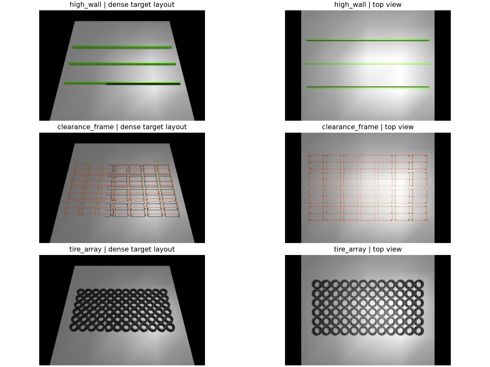

# 高墙、匍匐与轮胎阵：密集训练布局

当前布局已更新到5，新增连续课及加长梅花桩，见 [拼接更新](joined_update.md)；本页三类密集障碍的几何保持不变。

日期：2026-11-05。用户要求这三类障碍排满有效训练区。任务仍为
`LgDog1-Race-MGDP` / `race_mgdp`，地图布局修订号从3改为4。



## 当前排布（每个8×8m拼块）

| 项目 | 排列 | 前进方向占用 | 横向占用 |
|---|---|---|---|
| 高墙 | 3道横排，每道9个墙段，合计27段 | 中心x=2.3/3.7/5.1m | y=0.4–7.6m |
| 匍匐 | 7条通道，每条连续4个框架，合计28框 | x约1.69–5.51m | y约0.58–7.42m |
| 轮胎 | 横向12排、前进方向6列，合计72胎 | x约2.10–5.40m | y约0.70–7.30m |

高墙间净距1.32m，保留起落脚空间；匍匐框架中心间隔1m，形成连续低姿态练习；
轮胎中心间距仍为0.55m，中心线仍位于中间两排之间，保留参考阵列的横向相位。
单个墙段、框架和轮胎的目标尺寸及原有高度/净空难度递进不变。

每个拼块只有一块共享地板，没有在每个框架或轮胎下面重复叠加地板。
几何全部参与碰撞和深度射线，不是只供显示的复制品。
入口出生点仍为 `(1,4,0)`，直线出口为 `(6.3,4,0)`。
最早成功位置减去后足偏移后也已越过最后障碍，避免尚未完全出框就被判成功。

比赛预训练的相对出生x改为0.2–0.4m，即拼块绝对x=1.2–1.4m，放在首排框架之前；
额外出生高度为0.02–0.06m，避免沿用稀疏版位置时直接出生在顶梁内。

## 验证与使用边界

- 单元检查实际碰撞几何数量、墙排位置、轮胎间距和中心相位、全部通道的横梁射线、
  入口及出口落脚净空；原始单框/2×4轮胎配置仍可独立使用。
- 密集图增加了实际几何数量；GPU吞吐与显存占用没有在本轮验证。
- 地形指纹包含布局修订号4，旧稀疏v3的完整课程状态会被拒绝，不能继承其通过率和速度门控统计。
  任务名、v3实验目录、感知输出路径及策略输入尺寸保留；请开始新的训练run。
- 本轮只做CPU软件验证，不能据此宣称密集障碍已被策略学会。

本轮实际验证：255项回归，0失败、1跳过；完整10行×20列地图编译为33,324个地形几何，
全部200格的入口与直线出口射线检查通过。10环境/2行×10列的真实环境验证终点终止、
局部reset、课程保存恢复，并拒绝稀疏v3的旧课程状态。
密集图预训练采集24步，得到50条4步序列；2次更新保存感知文件，再完成1次CPU PPO更新、
导出、恢复及再次更新。日志位于 `.artifacts/dense-terrain/`。

本机完整地图生成阶段实测约230秒（并行校验负载下），初始化明显重于稀疏图；
这是实际密集碰撞/射线几何带来的代价，不能把该CPU时间作为GPU训练吞吐指标。

重建预览：

```bash
python -m scripts.preview_2027_training --output doc/analysis/terrain_2027_v3
python -m scripts.visualize_terrain --task LgDog1-Race-MGDP
```
