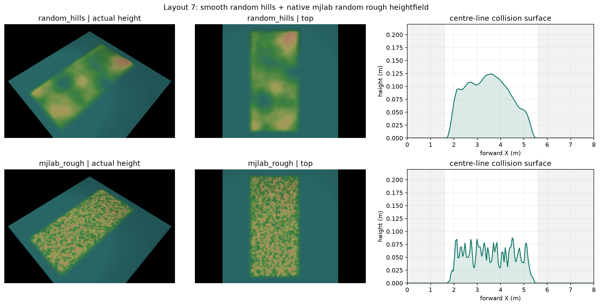
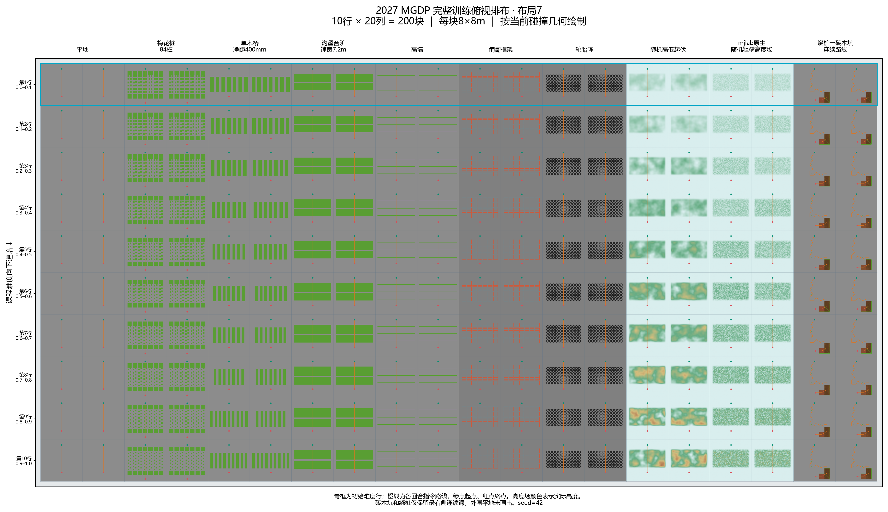

# 移除重复单项课，加入两类高度场

日期：2026-11-05。任务 `race_mgdp` / `LgDog1-Race-MGDP`，布局修订号7。

按截图移除单独“砖木坑”“绕桩”两类课程，保留“绕桩→砖木坑”拼接课。
旧版由一条小方块带构成的 `rough` 移除。新增两类真实可碰撞、可被深度射线和高程扫描读取的高度场：

| 新课程 | 原生生成器 | 难度递进 |
|---|---|---|
| 随机高低起伏 `random_hills` | mjlab `HfPerlinNoiseTerrainCfg`，3层噪声、较大空间尺度 | 峰值0.025→0.20m |
| mjlab原生随机粗糙 `mjlab_rough` | mjlab `HfRandomUniformTerrainCfg`，原始噪声0.02–0.10m、量化步长0.02m | 整体幅度缩放0.2→1，峰值约0.02→0.10m |

用户选择“仅原生随机粗糙高度场”，本次未加入默认坡面、台阶、波浪混合图。
原生随机粗糙生成器自身不使用difficulty，所以额外按课程难度缩放高度，保留其随机结构。
随机起伏固定seed可重现，改变seed会产生不同表面。

## 安全衔接和课程

两类新地形采用0.1m采样网格，起点仍为 `(1,4,0)`，终点仍为 `(6.3,4,0)`。
将高度场前后降为平地：x≤1.7m及x≥5.5m，采用0.5m平滑过渡带；
横向边缘同样平滑归零。验证包括前脚出生落点和最早成功位置的后脚落点。
颜色依据修改后的实际高度重算；没有添加覆盖高度场的平板或用装饰物替代碰撞。

当前10类各占10%，默认10行×20列，共200块：
平地、梅花桩、单木桥、沟壑、高墙、匍匐、轮胎阵、随机高低起伏、原生随机粗糙、绕桩→砖木坑。
内部保留砖木坑和绕桩几何构造器供拼接使用，但不再单独分配课程列。
梅花桩84桩、沟壑7.2m铺宽、单木桥400mm净距、密集高墙/匍匐/轮胎和75秒回合保持原配置。

俯视图按每块实际编译后的碰撞几何绘制；高度场颜色表示实际高度，外围平地省略。
可用 `python -m scripts.preview_2027_overview --output doc/analysis/terrain_2027_v3` 重新生成，
随图保存每块的类型、难度和几何数量。无需将整张图编译成一个超大模型。

## 训练与验证

任务、实验名与默认感知文件路径仍为v3，完整课程指纹更新为布局7。
需重新预训练感知并新开策略run；旧布局的掌握度、速度和通过率统计不能直接恢复。
回归检查课程移除/新增、真实高度场、随机种子、幅度递进、平整起终点及路线合同。
CPU集成检查与日志在 `.artifacts/heightfield-update/`。这些工程检查不等于策略越障成绩。

| 验证 | 结果 |
|---|---|
| 全套回归 | 260项，0失败、1跳过；`all-tests.log` |
| 实际CPU环境 | 10环境、2行×10列，3516个几何体、4个真实高度场 |
| 感知射线 | 两类新高度场均读到有效深度；每环境256条射线，数值有限 |
| 实际终止链路 | 设置合法最终路点后，10类均成功、复位并计数；旧布局完整状态被拒绝 |
| 当前俯视排布 | 200块、34746个地形几何体（不含外围平地），seed42；`full_topdown_metrics.json` |
| 静态检查 | `node --check src/dashboard/web/app.js`、`git diff --check`通过 |

本轮未执行GPU长时预训练或策略训练。
