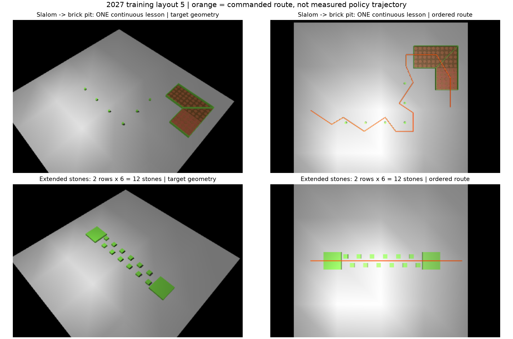

# 绕桩接砖木坑、加长梅花桩

日期：2026-11-05。`LgDog1-Race-MGDP` / `race_mgdp`，布局修订号5。

## 连续路线

保留绕桩和砖木坑单项课，另加 `slalom_brick` 组合课。六根L形矮桩的尺寸、位置及难度递进不变；
将原2×2m的L形砖木坑顺时针旋转90°并平移至绕桩出口右上方，共用一块8×8m地板。
砖木坑的底板、外护栏、斜栏和填充砖完整保留，参与碰撞与深度感知。

路线从 `(1,4)` 开始，走完绕桩后经 `(5.1,6.4)` 连接到 `(6.4,6.4)`，再经 `(7,5.4)` 穿过砖木坑，
最终到达 `(7,4.15)`。总路线约12.9m。坑体边界约x=5.49–7.51m、y=4.89–6.91m。
连接段保留平地，转弯路点避开斜护栏，机器人行进中跨过斜栏及出口护栏后才进入最终成功区。

路点索引、里程和课程计数贯穿整个回合；到绕桩原终点不会提前结束，必须依次经过连接段及砖木坑出口。
直接跳到终点也不能绕过前面路点。训练回合上限75秒，指令重采样76秒，避免中途重新开始。

## 加长梅花桩

双排各6桩、合计12桩，由参考模型的双排三桩单元沿前进方向重复两次。
目标桩长宽0.2m、高0.1m，前后间距0.6m、双排间距0.4m，第二排错位0.3m；
低难度仍采用宽桩、低桩、较小错位。入口平台x=1.4–2.2m，出口平台x=5.9–6.7m，
整段有效障碍区由约3.5m延长到5.3m。最终路点移至 `(7.5,4)`，避免站在出口平台上就计成功。

## 训练与兼容性

现在共11类课，10行×22列，每类各两列。高墙、匍匐、轮胎阵的密集排布保留。
工作台显示独立的“绕桩→砖木坑”通过率/样本数；课程扩速要求这类课也达到门槛。
reward不变，`foot_clearance=0`，`feet_air_time=0.25`。

实验目录仍为 `lgdog1_velocity_race_mgdp_v3`，感知文件仍为 `mgdp_race_v3.pt`。
布局版本、路线、地形列数及回合时间均进入课程指纹，布局4等旧完整训练状态会被拒绝恢复。
请为新图重新采集感知数据并新开策略训练，不要把旧run的通过率当作新图结果。

橙线仅为训练命令路线的可视化。路点控制与进度奖励要求机器人依次行进；
这不等于已训练策略能够可靠绕桩、转弯和跨越护栏，仍需GPU训练和实际轨迹评估。

## 验证

几何回归检查12桩、砖木坑刚体旋转及尺寸保留、单一地板、边界、连接段和安全出口；
命令回归检查连续课不在绕桩出口提前成功、不能跳终点、全段进度连续，以及最低0.25m/s理想跟踪可在75秒内完成。
实际CPU环境及训练检查记录见项目 `.artifacts/joined-terrain/`，不作为策略越障成绩。

| 检查 | 结果 |
|---|---|
| 全套回归 | 257项，0失败、1跳过；`verified-tests.log` |
| 静态检查 | `node --check src/dashboard/web/app.js`、`git diff --check`通过 |
| 实际11环境、2行×11列构建 | 3568个几何体，全部11类存在 |
| 强制设置最终路点及合法朝向，执行实际仿真步 | 11类均触发成功、复位和对应课程计数；布局4完整课程状态被拒绝 |
| 感知采集/更新 | 24步，55条连续4帧序列，CPU更新2次并保存独立烟测权重 |
| PPO链路 | CPU 11环境×4步，更新、保存、ONNX及感知sidecar导出、恢复后再更新 |

上述出口检查是手动设置状态后验证终止链路，不是策略自行走过整段路线。全套长时GPU训练未执行。
