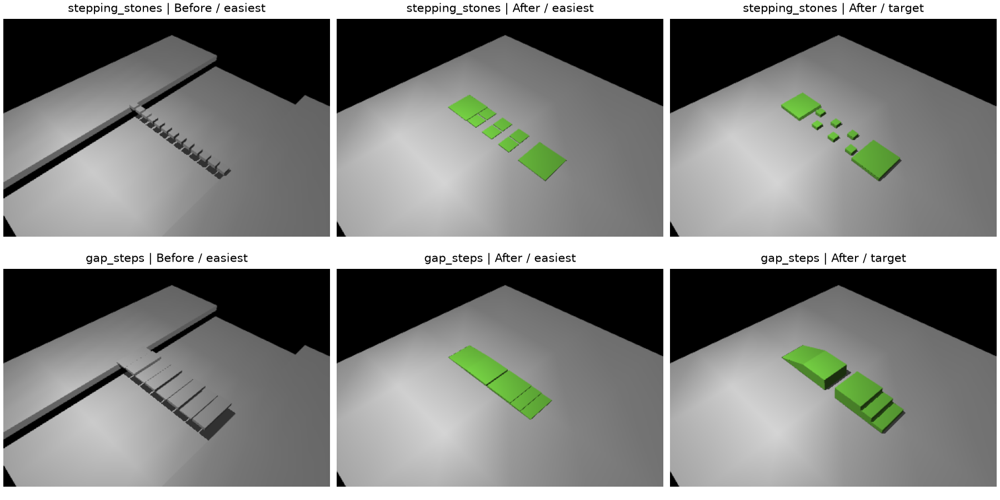
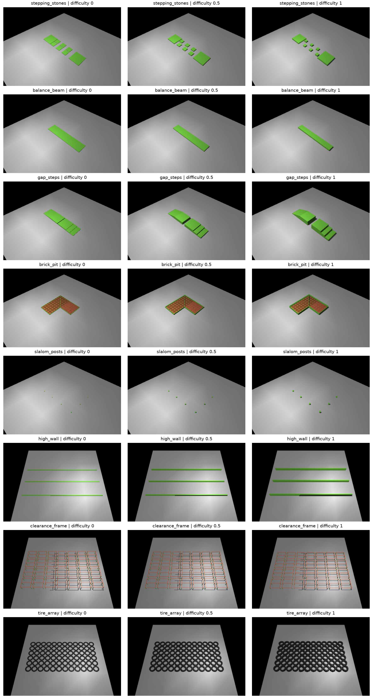
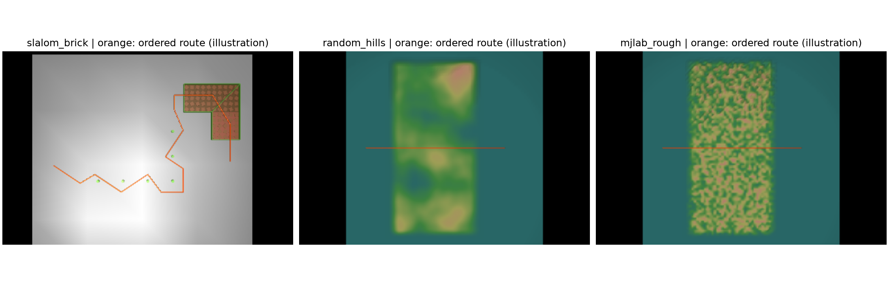

# 2027 MGDP 训练图 v3：来源、修复与验证

日期：2026-11-04。目标任务 `race_mgdp` / `LgDog1-Race-MGDP`。

2026-11-05：高墙、匍匐框架和轮胎阵已改为密集铺排，布局修订号4；
本文下方是v3初版的来源和验证记录，最新数量、布局及兼容性见 [密集版更新](dense_update.md)。
`lessons.png` 已更新为当前密集版预览。

## 场地图依据

用户提供：`E:/rl_vision/27rc-dog-race-main.zip`。与工作区副本逐字节 SHA-256 相同：

```text
7a221cdefb04a28e011ba476071fbeb6d4ea9cf67816e42be87e47f9c6a3e5c0
```

核对其中 `docs/modeling.md`、`docs/images/obstacle-top.png`、障碍 MJCF，
以及本项目已导入的 `src/assets/terrains/race_obstacle_2027.xml`。
这份场地是所提供仓库的比赛规则建模实现；不是对最终赛事摆位和摩擦参数的独立认证。
原比赛 XML、用户原始训练归档和已有 checkpoint 保留。

## 修改前的问题与新课程

| 项目 | 原训练图的问题 | v3 入门 → 目标端点 |
|---|---|---|
| 梅花桩 | 单列宽0.2m；LgDog1 默认左右足间距约0.324m，中心线行走时两侧脚都不在桩面上；下方额外挖0.45m坑 | 双排六桩；桩宽0.36→0.20m，高0.02→0.10m，错排0→0.30m；目标端点与参考六桩位置/尺寸一致 |
| 单木桥 | 同样使用非比赛深坑 | 地面上的3m桥，宽0.70→0.40m、高0.02→0.10m |
| 沟壑组合 | 薄踏板悬空，间隔和末端缺口不均；缺少斜坡/平台结构 | 实心坡、双0.8m平台、两级0.32m深踏步；平台高0.06→0.36m，间隙0.04→0.36m；端点坡20°、下台阶顶高0.24/0.12m |
| 绕桩 | 仅三根0.30–0.50m高柱，强制直走 | L形六圆柱；直径0.05→0.10m，高0.03→0.10m，间距0.9m；必须按路线转弯 |
| 砖木坑 | 直线碎块带，没有L形结构和护栏 | 2×2m L形、臂宽1m，固定碎料、周边栏和斜分隔栏；栏高0.025→0.15m |
| 高墙 | 比例与位置分布未明确对应完整墙体 | 单墙厚0.08m、宽0.8m，高0.04→0.30m |
| 限高 | 每格两笼，最低梁底0.28m | 单笼、内宽0.8m，梁底0.44→0.29m |
| 轮胎 | 初始胎高偏大 | 保留2×4环形轮胎；外/内半径0.2744/0.1646m，胎高0.025→0.165m；分段刚体近似 |

所有障碍置于同一地面，无人为负高度深坑。碎料和轮胎采用适合并行训练的固定刚体近似，
不模拟弹性、沉陷或碎料移动。目标端点 d=1 用于几何核对；生成器最高行采样接近1的难度。





## 路线、课程及数据

- 入口仍为每格局部 `(1,4,0)`；直线出口为 `(6.3,4,0)`。
- 绕桩和砖木坑使用 L 形分段路线，长度约8.69m与6.96m。进入当前路点0.15m内才推进，
  不能跳过前段直接到终点领取成功。机器人中心距当前段超过0.28m即失败。
- 进度奖励沿累计路线里程计算，包含Y向移动，往返不重复给分。reward 中
  `foot_clearance=0`、`feet_air_time=0.25` 继续保持。
- 每回合45秒、命令重采样46秒；接近路点减速，转弯使用对应朝向指令。
- 布局版本、路线和时间参数进入 checkpoint 指纹；实验目录改为
  `lgdog1_velocity_race_mgdp_v3`，旧v2的完整课程状态会被拒绝。
- 比赛感知预训练采集该障碍图，而不是只采普通Rough；输出独立文件
  `logs/mgdp/perception/mgdp_race_v3.pt`。工作台预训练和3D查看器均跟随当前任务。
- 3D查看器使用本次启动的独立端口，避免另一任务仍占8080时误显示旧地图。



这些课程训练局部运动技能。它们不包括整场路径规划、任务赛搬箱、正式计分、桩面接触次数判分，
也不能据此宣称机器人已经能自主通过整场比赛。原HIM比赛任务保留原训练配置供旧模型复现。

## 实际验证与边界

本机 CPU；环境/PPO seed42，预训练 seed0：

- 几何：核对参考六桩、坡台高度、平台净距、下台阶、六根L形矮桩、梁底净空；
  所有课在d=0/0.5/1的起终点射线均落在地面，没有负高度坑底。
- 路线：直接传送终点不能跳过中间路点；Y向进度及往返防刷分；
  理想运动学跟踪以0.25m/s在45秒内完成全部路线且不越界。这不是学习策略的物理越障测试。
- 真实环境：10环境、2行×10列加载全部障碍；强制设置已完成路线的安全终点，
  验证成功终止、局部reset和课程计数/状态恢复；实际旧v2课程状态被拒绝。
- 真实预训练：2027采集24步，得到50条4步有效序列；2次更新保存检查点，
  验证损失约1.324。仅用于软件流程验证。
- 真实CPU PPO：10环境、每环境4步、1次更新、checkpoint/ONNX/感知sidecar导出，
  使用上述新预训练文件，恢复后再更新。配套导出在完整比赛图完成0.2秒/10控制步接口检查，
  不是越障测试。3D查看器成功生成200格地图及LgDog1实例。
- 全套回归254项，0失败、1跳过；前端JS语法与diff检查通过。

执行日志和临时模型在 `.artifacts/terrain-review/`，不上传模型。没有执行GPU长训或实机测试，
训练收敛、落脚质量和实际越障成功率仍需用新run评估。

## 使用

```bash
python -m scripts.pretrain_mgdp --task LgDog1-Race-MGDP --num-envs 256 --steps 4000 --sequence-length 8 --iterations 3000
python lgdog.py train race_mgdp --envs 1024 --iterations 16000
python -m scripts.visualize_terrain --task LgDog1-Race-MGDP
python -m scripts.preview_2027_training --output doc/analysis/terrain_2027_v3
```

请开始新的v3 run。旧模型回放保留其原感知文件；本轮CPU短训练不作为可用策略发布。
